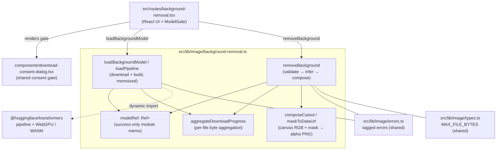
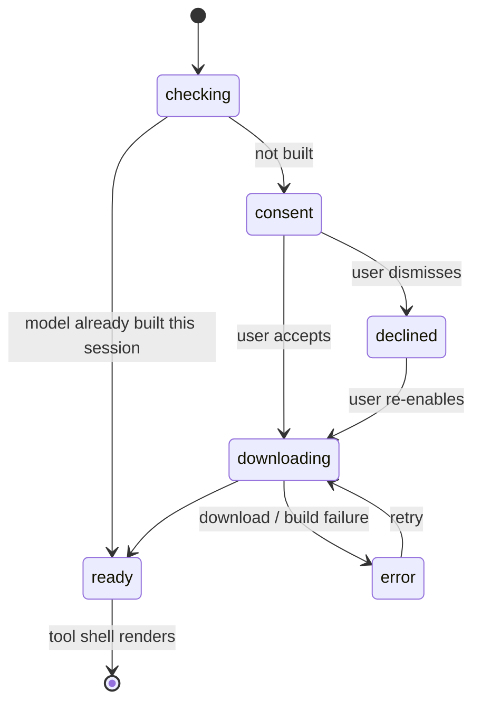
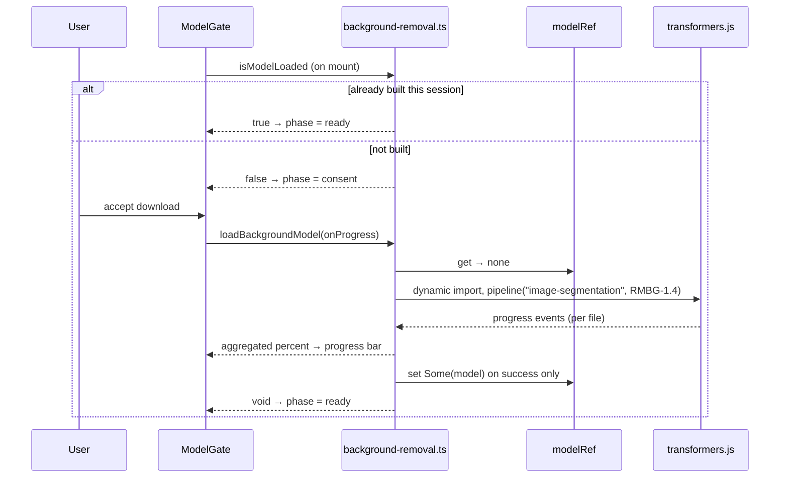
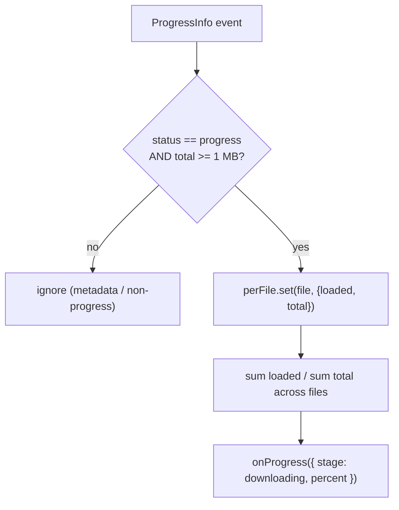
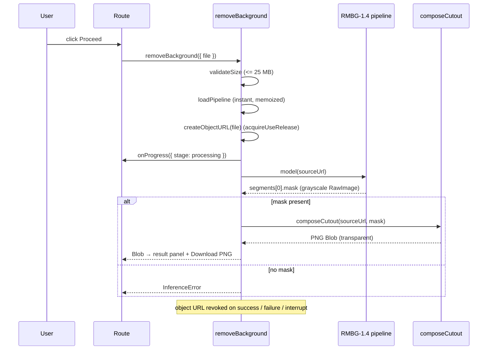
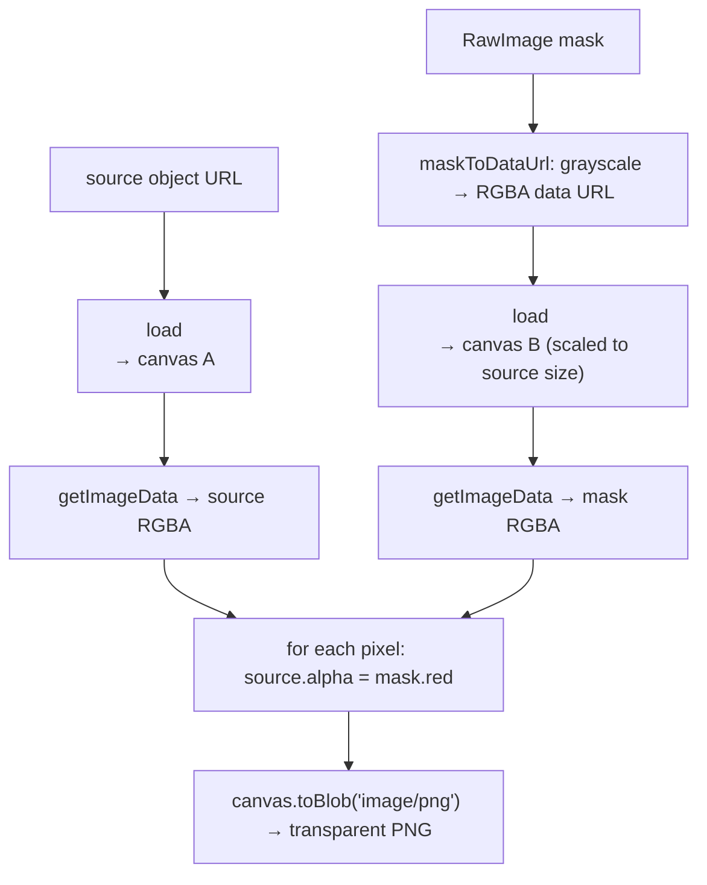

# Background Removal

Background removal cuts the subject out of a single image — pick a file, run the
model, and download a transparent PNG — entirely inside the browser. No bytes
leave the device. Unlike the [image converter](../src/routes/converter.tsx) and
[resizer](../src/routes/resizer.tsx), which run their pixel work in a Web Worker,
this feature runs a small on-device AI model (`briaai/RMBG-1.4` via
`@huggingface/transformers`) on the main thread. The model owns its own threading
(ONNX Runtime WASM workers, or WebGPU when available), so there is no wrapping
worker to manage — but there is a one-time ~180 MB model download, which the UI
fronts with a consent gate exactly like the video engine.

This document explains the whole feature end to end: the module layout, the model
load flow and its consent gate, the inference and compositing pipeline, the
download-progress aggregation, the input guardrails, and the device fallback. It
closes with the real problems we hit while building it and how each was resolved.

## Table of contents

1. [Goals and constraints](#goals-and-constraints)
2. [Module map](#module-map)
3. [High level architecture](#high-level-architecture)
4. [Model load flow and the consent gate](#model-load-flow-and-the-consent-gate)
5. [Download progress aggregation](#download-progress-aggregation)
6. [Removal flow](#removal-flow)
7. [Compositing the cutout](#compositing-the-cutout)
8. [Device selection and fallback](#device-selection-and-fallback)
9. [Input guardrails](#input-guardrails)
10. [Result and download](#result-and-download)
11. [Cross origin isolation](#cross-origin-isolation)
12. [Error model](#error-model)
13. [Problems we faced](#problems-we-faced)
14. [Testing](#testing)
15. [File reference](#file-reference)

## Goals and constraints

- **Offline first.** The image is never uploaded. Both the model download and the
  inference happen on device; the only network traffic is the one-time fetch of
  the model weights from the Hugging Face CDN.
- **On-device AI, not a service.** The cutout is produced by `RMBG-1.4`, an
  image-segmentation model run locally through `@huggingface/transformers`. There
  is no server round-trip per image.
- **One-time, consented download.** The model is ~180 MB. The route fronts it with
  the same `DownloadConsentDialog` the video engine uses, so the user opts in
  before any bytes are fetched. After the first download the weights and the
  ONNX Runtime files are stored in the Cache API (`palico-model-v1`, `palico-ort-v1`),
  so later visits skip the consent gate and the tool works offline (see
  [offline-pwa.md](./offline-pwa.md)).
- **Single image at a time.** This is a focused single-file tool (pick → preview →
  proceed → result), not a batch queue. There is no `MAX_FILES`.
- **Transparent PNG out.** The output is always a PNG with an alpha channel — the
  only format that can carry the transparency a cutout needs. The result panel
  previews it over a checkerboard so the transparency is visible.
- **Typed effects.** All logic outside the React layer uses Effect. Every failure
  is a tagged `Schema.TaggedError`. No raw throws on the error channel, no
  swallowed errors.
- **No `@huggingface/*` in the initial bundle.** The single module that imports
  transformers.js (`background-removal.ts`) only ever reaches it through
  `await import("@huggingface/transformers")` inside the load path, so the heavy
  dependency stays out of the route chunk until the user consents to the download.

## Module map



The feature is intentionally small: one library module
(`src/lib/image/background-removal.ts`) holds the entire pipeline — model loading,
the memo `Ref`, progress aggregation, inference, and the canvas compositing — and
the route (`src/routes/background-removal.tsx`) wires it to the UI. It reuses the
shared `DownloadConsentDialog`, the shared tagged errors in `errors.ts`, and the
`MAX_FILE_BYTES` cap from `types.ts`. Unlike the video tools there is **no
separate `engine.ts`**: transformers.js *is* the engine, and the pipeline instance
it returns is cached directly.

## High level architecture

The page has two visual states, driven by a local `GatePhase`:

1. **Model gate.** On mount the route checks whether the model is already built in
   this session (`isModelLoaded`). If not, it shows the consent dialog; on accept
   it drives the download and reports an aggregated percentage. Identical in shape
   to the video converter's engine gate.
2. **Tool shell.** Once the phase reaches `ready`, the page renders the dropzone;
   after an image is picked it shows the preview and a **Proceed** button, then an
   indeterminate "Removing background…" state, and finally a side-by-side
   Original / Background-removed result with a **Download PNG** button.



## Model load flow and the consent gate

The route never reimplements model loading; it calls two exported Effects from
`background-removal.ts`:

- `isModelLoaded: Effect<boolean>` — reads the module `Ref` and reports whether a
  pipeline is already built in this session.
- `loadBackgroundModel(onProgress?)` — downloads and builds the pipeline **without
  running inference**, so the gate can complete the one-time download up front,
  before any image is chosen (mirrors the video `loadEngine`).



The pipeline build lives in `buildPipeline(device, onEvent)`, wrapped in
`Effect.tryPromise`:

1. `await import("@huggingface/transformers")` — kept dynamic so transformers.js
   never lands in the route bundle.
2. `env.allowLocalModels = false` — only the CDN model is used.
3. `env.useCustomCache = true` with `env.customCache = modelCache`
   (`src/lib/image/model-cache.ts`), a `{ match, put }` object over our own Cache API
   bucket, so `isBackgroundModelCached` can answer "will this work offline?". The
   default transformers.js cache was unreliable on iOS Safari, so the 180 MB write must
   be checked on a real iPhone; if the browser does not keep it, the status shows "Not
   saved on this device".
3a. `env.backends.onnx.wasm.wasmPaths` points at same-origin ORT files
   (`src/lib/image/ort-assets.ts`). The default is jsdelivr, which fails offline. The
   consented download also stores them in `palico-ort-v1`, and the service worker serves
   them from there.
4. `pipeline("image-segmentation", "briaai/RMBG-1.4", { device, dtype: "fp32", progress_callback })`.

The built pipeline is memoized in a module-level `Ref<Option<SegmentationModel>>`
(`modelRef`), the same singleton pattern as `video/engine.ts`. Crucially the `Ref`
is set **only on success** — a failed download or build never reaches `Ref.set`, so
the user can simply click again to retry on a clean slate. Because the `Ref`
outlives the unmounted component, SPA re-navigation back to the page skips the gate
entirely; only a full page reload re-shows it (we can't cheaply detect a prior
visit's HTTP-cached weights).

## Download progress aggregation

The model is several files: tiny metadata (config, preprocessor) plus the large
weights. transformers.js reports download progress **per file**, and each small
metadata file finishes in a single chunk that fires one `progress` event at 100%
before the big weights file even starts. Forwarding raw per-file percentages would
spike the bar to 100%, reset to 0%, and repeat.

`aggregateDownloadProgress` instead accumulates bytes across files and reports a
single monotonic percentage — the same technique as `video/engine.ts`:



Sub-1 MB files are filtered out (`MIN_PROGRESS_BYTES`): without their totals known
up front, including them would still cause the early spike. The result is a bar
that tracks the weights download and climbs smoothly to 100%.

## Removal flow

When the user clicks **Proceed**, the gate has already guaranteed the model is
loaded, so this path is pure inference — no download, no consent. Inference decodes
and runs a neural net rather than streaming frames, so there is no fine-grained
progress; the UI shows an indeterminate "Removing background…" state.



The pipeline lives in `removeBackground(input)`:

1. `validateSize(file)` rejects anything over `MAX_FILE_BYTES` (25 MB) with a
   `FileTooLargeError`.
2. `loadPipeline(...)` returns the memoized model (or builds it if somehow not yet
   loaded — idempotent).
3. `useSourceUrl` wraps the work in `Effect.acquireUseRelease`, creating an object
   URL for the file and **always revoking it** on success, failure, or interrupt.
4. `onProgress({ stage: "processing" })` flips the UI to the indeterminate state.
5. `model(sourceUrl)` runs segmentation; a missing `segments[0].mask` is an
   `InferenceError`.
6. `composeCutout(sourceUrl, mask)` produces the transparent PNG `Blob`.

`removeBackground` returns
`Effect<Blob, BackgroundRemovalError>`.

## Compositing the cutout

The model returns a grayscale **mask** (a `RawImage` where each pixel's value is
the subject-confidence / alpha). Turning that into a transparent PNG is pure
canvas work — `composeCutout`:



Steps:

1. `maskToDataUrl(mask)` paints the grayscale mask onto a canvas (each value
   written to R, G, B with full alpha) and returns a data URL.
2. The source image is drawn to one canvas and the mask drawn — **scaled to the
   source's dimensions** — to another, so the two `ImageData` buffers align even if
   the model emitted a mask at a different resolution.
3. Each source pixel's alpha byte is replaced with the mask's red byte, cutting out
   the background.
4. `canvas.toBlob(…, "image/png")` encodes the result, preserving the alpha channel.

`maskToDataUrl` is plain synchronous canvas code; `composeCutout` is async (it
awaits two `` decodes) and is wrapped at the call site in `Effect.tryPromise`
that classifies failures into `DecodeError` (message mentions "decode") or
`EncodeError` (the catch-all PNG encode failure).

## Device selection and fallback

`loadPipeline` tries WebGPU first and falls back to WASM with a plain
`Effect.orElse`:

```typescript
buildPipeline("webgpu", onEvent).pipe(
  Effect.orElse(() => buildPipeline("wasm", onEvent)),
)
```

WebGPU runs the model on the GPU and is markedly faster where supported. On
browsers without it (or where pipeline construction throws for WebGPU), the WASM
path runs the same ONNX graph on CPU via ONNX Runtime's WASM workers. Either way
the call returns the same `SegmentationModel` callable, so the rest of the pipeline
is device-agnostic.

## Input guardrails

The tool is single-file, so there is no batch cap. Two checks gate a picked file:

### Type validation

The file picker is `accept="image/*"`, and `selectFile` additionally rejects any
file whose `type` does not start with `image/` with a toast. Anything the browser
can decode as an image is accepted — the model and canvas pipeline don't care about
the container.

### Size cap

`validateSize` rejects files over `MAX_FILE_BYTES` (25 MB, shared with the image
converter) with a `FileTooLargeError` whose message names the file and the limit.
The ceiling exists because the whole image is decoded into canvas `ImageData` plus
fed to the model — large images can exhaust memory or stall inference.

## Result and download

A successful removal is **not** auto-downloaded. The result panel shows the
original and the cutout side by side, the cutout rendered over a CSS checkerboard
so its transparency is visible. The user downloads explicitly via **Download PNG**,
which names the file from the source (`photo.jpg` → `photo-no-bg.png`). **Start
over** clears the source and result and resets the picker.

## Cross origin isolation

ONNX Runtime's multi-threaded WASM backend uses `SharedArrayBuffer`, which requires
the page to be cross-origin isolated. The same
`Cross-Origin-Opener-Policy: same-origin` and
`Cross-Origin-Embedder-Policy: require-corp` headers that the video tools need for
`ffmpeg.wasm` are set in `src/server.ts` and `vite.config.ts`, so this feature
inherits them for free. Without isolation, ORT would fall back to single-threaded
WASM (slower) rather than fail. See
[video-converter.md → Cross origin isolation](./video-converter.md#cross-origin-isolation-coop--coep)
for the full setup.

## Error model

All failures are tagged errors from `src/lib/image/errors.ts`, unioned as
`BackgroundRemovalError`:

- `FileTooLargeError` (shared): the picked file exceeds `MAX_FILE_BYTES`. Carries
  `fileName`, `size`, `limit`, and a human `message`.
- `ModelLoadError` (new for this feature): the model download or pipeline build
  failed (network, WebGPU + WASM both unavailable, CDN error). Never poisons the
  memo `Ref`, so retry is a fresh attempt.
- `InferenceError` (new): the model threw, or returned no mask. Carries `fileName`.
- `DecodeError` (shared): the source image could not be decoded during compositing.
- `EncodeError` (shared): the cutout PNG could not be encoded. Carries `format`.

The route maps each tag to a friendly message in `userMessageFor` and surfaces it
via the gate's error panel (for load failures) or a toast (for per-image failures).
Because every error is typed and carries its own `message`/context, no string
parsing is needed at the call site.

## Problems we faced

### 1. The download bar spiked to 100% then reset

transformers.js reports progress per file, and the model's small metadata files
each fire a single `progress` event at 100% before the large weights file starts.
Forwarding raw per-file percentages made the bar jump to 100%, snap back to 0%, and
crawl up again — confusing for a one-time 180 MB download. `aggregateDownloadProgress`
sums loaded/total bytes across files and reports one monotonic percentage, and
filters out sub-1 MB files (`MIN_PROGRESS_BYTES`) whose unknown totals would still
cause the early spike.

### 2. The model wouldn't cache on iOS Safari

transformers.js defaults to storing weights via the Cache API, which behaved
unreliably inside iOS Safari (and in some embedded webviews): downloads appeared to
"re-fetch" every visit. We first disabled that layer (`env.useBrowserCache = false`) and
relied on the HTTP cache, but the HTTP cache cannot be queried, so the consent gate
reappeared on every reload and the tool could not work offline. It now uses a custom
cache over our own Cache API bucket (`src/lib/image/model-cache.ts`), the same mechanism
as the ffmpeg and ZetaOffice engines. Whether iOS keeps a 180 MB write there is
unverified on a device; see [offline-pwa.md](./offline-pwa.md#testing).

### 3. WebGPU isn't everywhere

WebGPU gives a big inference speedup but isn't universally available, and
constructing a WebGPU pipeline can throw on unsupported browsers. Rather than
feature-detect, `loadPipeline` simply tries `buildPipeline("webgpu")` and
`Effect.orElse`s to `buildPipeline("wasm")` — the typed error channel makes the
fallback a one-liner, and the rest of the code is identical for both devices.

### 4. A failed download must not block retry

If the build failed and we'd cached the rejected attempt, the user would be stuck.
The memo `Ref` is written **only after** a successful build (`Ref.set` is reached
only on the success path), so a failure leaves `modelRef` as `none` and the next
**Try again** click runs a clean load.

### 5. Keeping transformers.js out of the route bundle

transformers.js is large. The only place it is referenced is the dynamic
`await import("@huggingface/transformers")` inside `buildPipeline`, so it is never
in the initial route chunk — it is fetched lazily as part of the consented model
load, alongside the weights.

### 6. Aligning a mismatched mask to the source

The model can emit a mask at a resolution that differs from the source image. Naively
copying mask bytes into the source's alpha would misalign the cutout. `composeCutout`
draws the mask **scaled to the source dimensions** onto its own canvas before reading
it back, so the two `ImageData` buffers are the same size and the per-pixel alpha
copy lines up exactly.

## Testing

The pipeline depends on a real browser, WebGPU/WASM, network model download, and
canvas compositing, so it is validated manually in `bun run dev` rather than by unit
tests: load the gate cold (consent → download → ready), confirm SPA re-navigation
skips the gate, run removal on a few images, and verify the PNG opens with
transparency. The shared helpers it relies on (`MAX_FILE_BYTES`, the tagged errors)
are exercised by the converter/resizer suites under `bun run test`.

## File reference

| File                                          | Responsibility                                                                       |
| --------------------------------------------- | ------------------------------------------------------------------------------------ |
| `src/routes/background-removal.tsx`           | UI: model gate, dropzone, preview, proceed, side-by-side result, download            |
| `src/lib/image/background-removal.ts`         | `loadBackgroundModel`, `removeBackground`, `isModelLoaded`, progress + compositing   |
| `src/components/download-consent-dialog.tsx`  | Shared one-time-download consent gate (also used by the video engine)                |
| `src/lib/image/errors.ts`                     | `ModelLoadError`, `InferenceError` + shared `FileTooLargeError`/`DecodeError`/`EncodeError` |
| `src/lib/image/types.ts`                      | Shared `MAX_FILE_BYTES` cap                                                           |
| `src/server.ts` / `vite.config.ts`            | Shared: COOP/COEP headers enabling `SharedArrayBuffer` for ORT WASM threads          |
