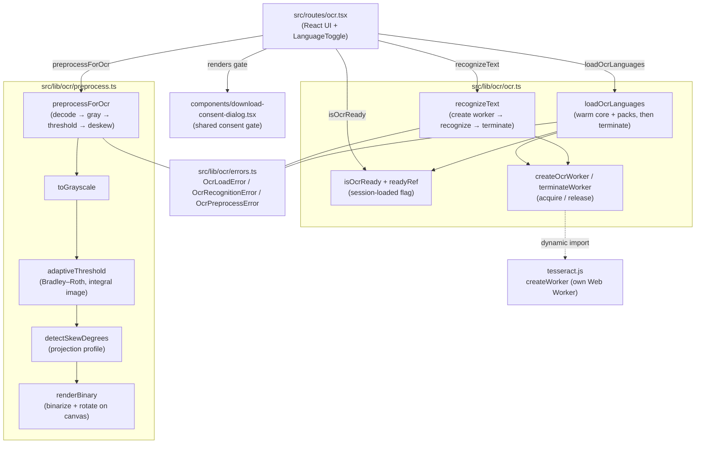
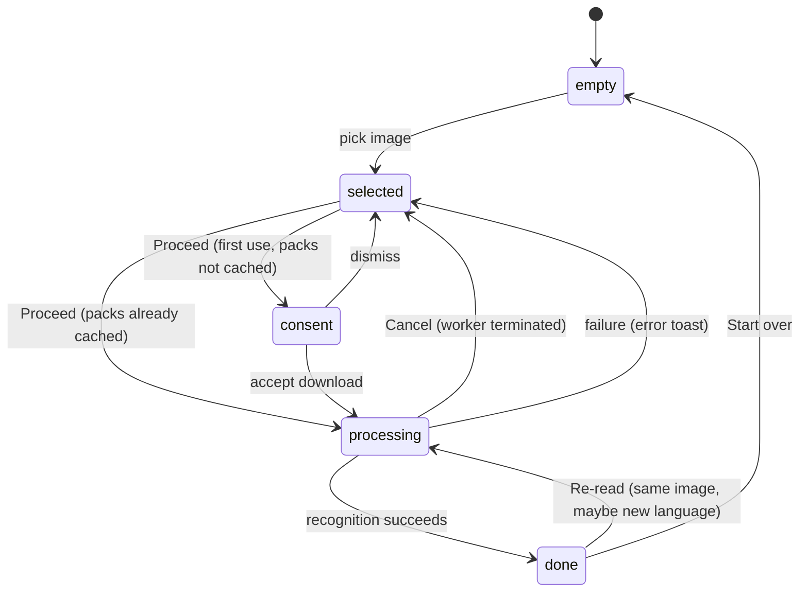
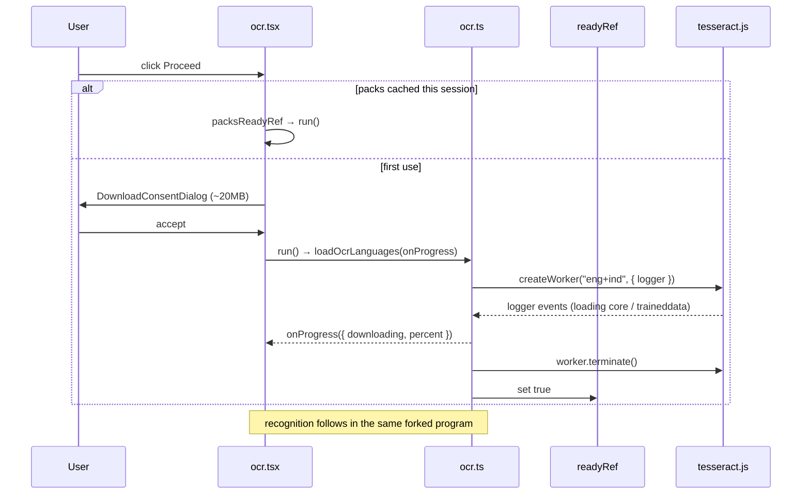
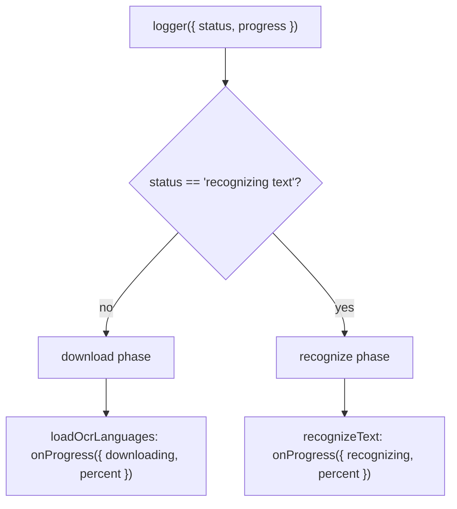
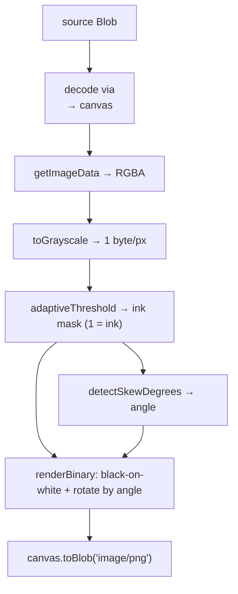
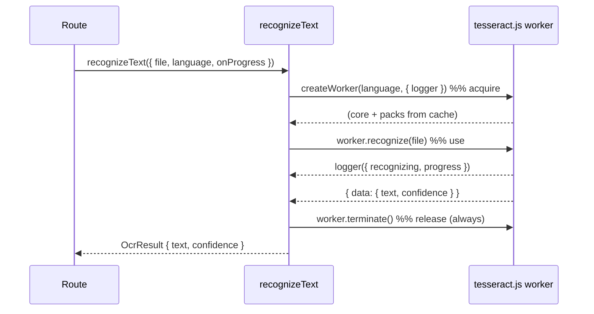

# Extract Text (OCR)

Extract Text pulls the words out of a single image — a photo, a screenshot, or a
scanned page — and hands back editable, copyable text, **entirely inside the
browser**. No bytes leave the device. The recognition engine is
[Tesseract.js](https://github.com/naptha/tesseract.js) (a WebAssembly port of the
Tesseract OCR engine), driven with two language packs — **English** and
**Indonesian** — that are downloaded once on first use and cached.

Like [background removal](./background-removal.md), this is an on-device model
feature rather than a service call, and it fronts a one-time download (~20 MB of
WASM core + language data) with a consent dialog. Unlike background removal, which
runs its model on the main thread, Tesseract.js **already runs recognition in its
own Web Worker**, so there is no wrapping worker to manage here either — wrapping a
self-threaded engine in another worker would just be a worker inside a worker. The
lib layer talks to it directly through Effect.

This document explains the whole feature end to end: the module layout, the
Proceed-gated download flow, the two-phase progress model, the canvas
preprocessing that lifts accuracy on real photos, the recognition pipeline and how
Cancel terminates it, the result view, and the error model. It closes with the
real decisions and problems we hit while building it.

## Table of contents

1. [Goals and constraints](#goals-and-constraints)
2. [Module map](#module-map)
3. [High level architecture](#high-level-architecture)
4. [Why there is no wrapping worker](#why-there-is-no-wrapping-worker)
5. [The download flow and the consent gate](#the-download-flow-and-the-consent-gate)
6. [Two-phase progress](#two-phase-progress)
7. [Preprocessing pipeline](#preprocessing-pipeline)
8. [Recognition flow](#recognition-flow)
9. [Cancellation](#cancellation)
10. [Language selection and re-reading](#language-selection-and-re-reading)
11. [The result view](#the-result-view)
12. [Caching model](#caching-model)
13. [Cross origin isolation](#cross-origin-isolation)
14. [Error model](#error-model)
15. [Problems and decisions](#problems-and-decisions)
16. [Testing](#testing)
17. [File reference](#file-reference)

## Goals and constraints

- **Offline first.** The image is never uploaded. Both the language-pack download
  and the recognition happen on device; the only network traffic is the one-time
  fetch of the Tesseract WASM core and the `eng`/`ind` traineddata from a CDN.
- **On-device OCR, not a service.** Text is recognized locally by Tesseract.js.
  There is no per-image server round-trip.
- **One-time, consented download.** The WASM core plus both language packs total
  ~20 MB. A `DownloadConsentDialog` — the same component the video engine and
  background removal use — negotiates the download before any bytes are fetched.
  After the first run the browser caches everything, so later runs skip straight to
  recognition.
- **Printed text only (v1).** Tesseract handles printed and typeset text well.
  Handwriting is explicitly **out of scope** — it needs a heavier detection + TrOCR
  pipeline (~350 MB), tracked as future work. Don't market this as a handwriting
  reader.
- **Single image at a time.** A focused pick → preview → proceed → result tool, not
  a batch queue. Batch is future work.
- **Editable text out.** The recognized text lands in an editable textarea so the
  user can fix the odd misread before copying. OCR is never perfect; the UI treats
  its output as a draft, not a verdict.
- **Typed effects.** All logic outside the React layer uses Effect. Every failure
  is a tagged `Schema.TaggedError`. No raw throws on the error channel, no swallowed
  errors.
- **Tesseract.js out of the initial bundle.** The only references to `tesseract.js`
  are `await import("tesseract.js")` inside the load and recognize paths, so the
  dependency stays out of the route chunk until the user consents to the download.

## Module map



The feature is deliberately small and self-contained in `src/lib/ocr/`, with its
own `errors.ts` rather than reusing the image domain's errors:

- **`ocr.ts`** holds the engine glue — creating and terminating Tesseract workers,
  the load path, the recognize path, the two-phase progress mapping, and the
  session-ready flag.
- **`preprocess.ts`** holds the pure, testable image math (grayscale, adaptive
  threshold, skew detection) plus the canvas orchestration that produces the
  cleaned-up image fed to recognition.
- **`errors.ts`** holds the three tagged errors.
- **`ocr.tsx`** is the route: it wires the lib to the UI and owns all React state.

## High level architecture

The page is a small state machine driven by a local `Status` (`idle` →
`processing` → `done`) plus a `source` file and a `consentOpen` flag. Unlike the
background-removal gate, which blocks the **whole tool** until the model is
downloaded, OCR lets you pick an image and choose a language first — the download
is gated on the **Proceed** action, the first time you use it.



The four visible states:

1. **Empty.** A titled empty state with a "Choose image" button.
2. **Selected.** Preview, a "runs on your device" note, an
   English / Indonesian / Both language toggle (default **Both**), and twin
   **Change image** / **Proceed** buttons.
3. **Processing.** The **Change image** button becomes a destructive **Cancel**
   (which just terminates — no confirmation dialog), **Proceed** becomes a disabled
   spinner, and a progress bar shows a distinct label per phase ("Downloading
   language packs…" vs "Reading text…").
4. **Done.** The image shifts left and an editable result panel slides in on the
   right. Covered in [The result view](#the-result-view).

## Why there is no wrapping worker

The image converter and resizer run their pixel work in a dedicated Web Worker
(`src/workers/image-converter.worker.ts`) because canvas work would otherwise block
the main thread. OCR does **not** get its own worker, for the same reason
background removal doesn't: the engine already owns its threading.

`tesseract.js`'s `createWorker()` spins up its own Web Worker internally and runs
the WASM recognition there. If we wrapped that in `src/workers/ocr.worker.ts`, we'd
have a worker whose only job is to create another worker — pure overhead, and it
would make progress callbacks and cancellation harder to plumb. So `ocr.ts` calls
Tesseract.js directly from the lib layer, exactly as `background-removal.ts` calls
transformers.js directly. Recognition still never blocks the UI thread, because
Tesseract's own worker carries it.

Cancellation and cleanup are handled with Effect's `acquireUseRelease` rather than
worker lifecycle management: the acquire step creates the Tesseract worker, the use
step recognizes, and the release step **always** terminates the worker — on
success, on failure, and on interruption. That last case is how **Cancel** works
(see [Cancellation](#cancellation)).

## The download flow and the consent gate

The route never talks to Tesseract.js directly for loading; it calls three exports
from `ocr.ts`:

- `isOcrReady: Effect<boolean>` — reads a module-level `Ref<boolean>` (`readyRef`)
  and reports whether the packs have been warmed in **this session**.
- `loadOcrLanguages(onProgress?)` — downloads and caches the WASM core and **both**
  language packs without recognizing anything, then terminates the temporary
  worker and flips `readyRef` to `true`.
- `recognizeText(input)` — the per-image recognition path (next section).

On **Proceed**, the route decides between the dialog and a direct run using a ref,
not state (the value is only read inside handlers, so a `useRef` avoids a needless
re-render):

```typescript
function proceed() {
  if (!source) return;
  if (packsReadyRef.current) {
    run(source, language);       // cached → straight to recognition
  } else {
    setConsentOpen(true);        // first use → consent dialog
  }
}
```



`loadOcrLanguages` warms the caches with a throwaway worker:

```typescript
export const loadOcrLanguages = (onProgress?) =>
  Effect.acquireUseRelease(
    createOcrWorker("eng+ind", (m) => {
      if (!isRecognizing(m.status)) {
        onProgress?.({ stage: "downloading", percent: clampPercent(m.progress) });
      }
    }),
    () => Ref.set(readyRef, true),   // use: mark ready
    terminateWorker,                 // release: always terminate
  );
```

Creating a worker with both languages (`"eng+ind"`) triggers the download of the
core and both traineddata files; terminating it afterwards is fine because the
downloaded assets persist in the cache (see [Caching model](#caching-model)). The
next `recognizeText` call re-creates a worker in milliseconds from cache.

`readyRef` lets an SPA re-navigation back to `/ocr` skip the dialog for the rest of
the session. A full page reload re-shows it, because we can't cheaply detect the
prior visit's cached assets from JS (the same trade-off background removal makes).

## Two-phase progress

Tesseract.js reports progress through a single `logger` callback that fires for
**every** stage — loading the core, fetching and initializing traineddata,
initializing the API, and finally recognizing. Each carries a `status` string and a
`progress` value in `[0, 1]`. The UI needs to distinguish the one-time **download**
phase from the per-image **recognition** phase so it can label the bar correctly.

The whole distinction rests on one status string:

```typescript
// Only this status is the recognition pass; everything else is setup/download.
const isRecognizing = (status: string) => status === "recognizing text";
```



The two entry points each forward **only their own** phase, so labels never bleed:

- `loadOcrLanguages` forwards events **while `status != "recognizing text"`** as
  `{ stage: "downloading" }`.
- `recognizeText` forwards events **while `status == "recognizing text"`** as
  `{ stage: "recognizing" }`, and ignores the brief cache-load statuses its own
  worker emits at startup (those already happened during the consented download).

`OcrProgress` is a schema union the route pattern-matches to pick the bar label:

```typescript
export const OcrProgress = Schema.Union(
  Schema.Struct({ stage: Schema.Literal("downloading"), percent: Schema.Number }),
  Schema.Struct({ stage: Schema.Literal("recognizing"), percent: Schema.Number }),
);
```

## Preprocessing pipeline

Raw phone photos of documents OCR poorly: uneven lighting, shadows, and a few
degrees of tilt all hurt. Before recognition, `preprocessForOcr` runs a **canvas-only**
cleanup — no OpenCV.js. It is applied **best-effort**: if preprocessing throws, the
route falls back to the original file rather than failing the whole read (see
[Recognition flow](#recognition-flow)).



The three heavy steps are **pure functions** (no canvas, no DOM), which is what
makes them unit-testable:

### Grayscale

`toGrayscale` collapses RGBA to one luma byte per pixel using Rec. 601 weights
(`0.299 R + 0.587 G + 0.114 B`).

### Adaptive threshold

`adaptiveThreshold` is a **Bradley–Roth** local threshold built on an **integral
image** (summed-area table). A pixel becomes *ink* when it is more than a fixed
percentage darker than the mean of its `S × S` neighbourhood:

```
ink  ⇔  gray * count * 100  <  windowSum * (100 - t)
```

Because the cutoff is **local**, a shadow gradient or uneven lighting that would
smear a single global threshold is handled cleanly — the mean tracks the local
background. The integral image makes each window sum an O(1) lookup, so the whole
pass is O(pixels). Output is `1 = ink`, `0 = paper`.

### Deskew

`detectSkewDegrees` estimates page tilt by **projection profile**: for each
candidate angle it shears the ink mask and scores how tightly ink stacks into rows
(`Σ rowCount²`). Level text concentrates into a few dense rows, maximising the
score; the winning angle is the skew. Work is capped by a sampling `stride` so the
cost is bounded regardless of image size — a skew estimate only needs a sample of
the ink.

`renderBinary` then paints the ink mask as black-on-white and, if the angle clears
`DESKEW_THRESHOLD_DEG` (0.5°), rotates it level on a canvas grown to the rotated
bounding box (so nothing is clipped and the margins stay paper-white). Below the
threshold it skips the rotation — a straight screenshot detects ≈ 0° and passes
through untouched, which is why screenshots aren't harmed by the pipeline.

> **ponytail note in the source:** these are pure-canvas heuristics on purpose.
> Upgrading to OpenCV's `adaptiveThreshold` + `minAreaRect`/`HoughLines` deskew is
> tracked separately and only worth doing if real photos still disappoint — it
> pulls in a multi-MB WASM dependency this deliberately avoids.

## Recognition flow

`recognizeText` is the per-image path. It wraps the whole thing in
`acquireUseRelease` so the Tesseract worker is guaranteed to terminate:



The route composes preprocessing + recognition (plus a first-run download) into one
Effect and forks it:

```typescript
const program = Effect.gen(function* () {
  const cached = yield* isOcrReady;
  if (!cached) yield* loadOcrLanguages(setProgress);        // download phase
  const prepared = yield* preprocessForOcr(file).pipe(
    Effect.orElseSucceed(() => file as Blob),               // best-effort
  );
  return yield* recognizeText({ file: prepared, language: lang, onProgress: setProgress });
});
```

`OcrResult` carries the recognized `text` (trimmed) and Tesseract's **mean word
confidence** (`data.confidence`, 0–100), which drives the low-confidence banner in
the result view.

## Cancellation

The issue is explicit: Cancel mid-run must just terminate the worker, with **no**
confirmation dialog. This falls out of Effect's structured concurrency for free.

The program is started with `Effect.runFork`, which returns a fiber the route keeps
in a ref. **Cancel** interrupts that fiber:

```typescript
const fiber = Effect.runFork(program);
fiberRef.current = fiber;

// Cancel button:
function cancel() {
  const fiber = fiberRef.current;
  fiberRef.current = null;
  if (fiber) Effect.runFork(Fiber.interrupt(fiber));
  setStatus("idle");
}
```

Interrupting the fiber unwinds the `acquireUseRelease` scopes inside `recognizeText`
(and `loadOcrLanguages`, if still downloading), whose **release steps terminate the
Tesseract worker**. No confirmation, no dangling worker.

The fiber's completion is handled by an observer that distinguishes the three
outcomes via the `Exit`:

```typescript
fiber.addObserver((exit) => {
  if (fiberRef.current !== fiber) return;          // superseded by a newer run
  fiberRef.current = null;
  if (Exit.isSuccess(exit)) { /* set result + text, status = done */ return; }
  if (Cause.isInterruptedOnly(exit.cause)) return; // user cancelled → no toast
  const failure = Option.getOrUndefined(Cause.failureOption(exit.cause));
  toast.error(userMessageFor(failure));            // real failure → toast
  setStatus("idle");
});
```

An **interrupt is not a failure**, so cancelling never shows an error toast. A
genuine `OcrLoadError`/`OcrRecognitionError` does.

## Language selection and re-reading

The language toggle offers **English**, **Indonesian**, and **Both** (default), and
maps to Tesseract language strings:

| Toggle       | Tesseract langs |
| ------------ | --------------- |
| English      | `eng`           |
| Indonesian   | `ind`           |
| Both         | `eng+ind`       |

`loadOcrLanguages` always downloads **both** packs up front, so switching languages
never triggers a new download — `recognizeText` just creates its worker with the
chosen subset, reading the already-cached traineddata. The toggle stays visible in
the result view, and a **Re-read** button re-runs the *same* image with the current
language — handy when "Both" produces cross-language noise and one language alone
reads cleaner.

The toggle is a native segmented control: visually-hidden `<input type="radio">`
elements inside styled `<label>`s (native radios over ARIA roles), so keyboard and
screen-reader behaviour comes for free.

## The result view

On success the layout switches to a two-column grid (stacked on mobile). The image
shifts left and the result panel slides in from the right, using `tw-animate-css`
utilities with `motion-reduce:animate-none` so the motion respects
`prefers-reduced-motion` (per the design system).

- **Left column:** the image (a small thumbnail on mobile, larger on desktop), the
  language toggle, **Start over**, and **Re-read**.
- **Right column:** an **editable** `<textarea>` holding the recognized text (so the
  user can correct a misread before copying), a copy-to-clipboard icon button, and
  conditionally:
  - a **low-confidence banner** when mean confidence `< LOW_CONFIDENCE` (60) and
    there *is* text — "this looks unreliable — try a sharper image, or switch the
    language and re-read";
  - a friendly **"No text found"** empty state (rendered **in the panel**, not as a
    toast) when the recognized text is blank.

The editable text lives in its own `text` state, seeded from the result on success;
copy uses the edited value, and the empty/low-confidence checks read it too.

## Caching model

Two independent caches make the second run fast, and both are managed by
Tesseract.js — we don't hand-roll a Cache-API layer:

- **WASM core + worker script:** fetched from the CDN and held by the browser's
  ordinary **HTTP cache**.
- **Language traineddata (`eng`, `ind`):** stored by Tesseract.js in **IndexedDB**
  (its default `cacheMethod: "write"`). This survives full page reloads, so the
  ~20 MB download truly is one-time across sessions.

`readyRef` is a lighter, session-scoped signal on top of that: it only records
whether *this* session already warmed the caches, so the consent dialog is skipped
on SPA re-navigation. It intentionally does **not** try to introspect IndexedDB to
skip the dialog on a cold reload — that check isn't worth the complexity, so a fresh
page load shows the dialog once more even though the download itself is a no-op.

## Cross origin isolation

Tesseract's threaded WASM build uses `SharedArrayBuffer` for multi-threaded
recognition, which requires the page to be cross-origin isolated. The
`Cross-Origin-Opener-Policy: same-origin` and
`Cross-Origin-Embedder-Policy: require-corp` headers the video tools and background
removal already need are set in `src/server.ts` and `vite.config.ts`, so this
feature inherits them for free and gets the faster multi-threaded path. Without
isolation Tesseract falls back to single-threaded WASM (slower) rather than
failing. See
[video-converter.md → Cross origin isolation](./video-converter.md#cross-origin-isolation-coop--coep)
for the full setup.

## Error model

All failures are tagged errors from `src/lib/ocr/errors.ts`:

- `OcrLoadError` — the WASM core or a language pack failed to download or
  initialize (network, CDN error). Carries a human `message`. `readyRef` is only
  flipped on the success path, so a failed load leaves the tool ready to retry on
  the next Proceed.
- `OcrRecognitionError` — `worker.recognize` threw. Carries a `message`.
- `OcrPreprocessError` — decode/threshold/encode failed during preprocessing. This
  one is **swallowed by design** at the call site (`Effect.orElseSucceed(() => file)`),
  so a preprocessing hiccup degrades to recognizing the raw image instead of
  failing the read. It exists as a typed value so preprocessing stays on the Effect
  error channel rather than throwing.

`OcrError` is the union of the first two — the errors that can actually reach the
route. The route maps each tag to a friendly message in `userMessageFor` and shows
it as a toast; because every error carries its own `message`, no string parsing is
needed at the call site.

## Problems and decisions

### 1. A worker inside a worker

The tracking issue named `src/workers/ocr.worker.ts`, but `tesseract.js`'s
`createWorker()` already runs recognition in its own Web Worker. Adding our own
worker around it would be a worker whose only job is to spawn another worker —
redundant, and it complicates progress and cancellation. We followed the codebase's
own precedent (`background-removal.ts` runs its self-threaded engine on the main
thread too) and drive Tesseract directly from the lib. Recognition still never
blocks the UI thread.

### 2. Two phases through one callback

Tesseract.js multiplexes core-loading, traineddata-loading, init, and recognition
progress through a single `logger`. Rather than parse the many status strings, we
key the whole download-vs-recognize split on the one string that matters —
`"recognizing text"` — and have each entry point forward only its own phase. Clean
labels, no leakage.

### 3. Gate at Proceed, not at the tool

Background removal blocks the entire tool behind its model download. For OCR that
felt heavy: picking an image and choosing a language costs nothing, so the download
is deferred to the first **Proceed** and negotiated with the consent dialog there.
Subsequent runs (cached) skip straight to recognition.

### 4. Preprocessing must never block a read

Aggressive binarization can occasionally misfire on an odd image. Making
preprocessing best-effort (`orElseSucceed(() => file)`) means a preprocessing
failure silently falls back to recognizing the original image, so the user always
gets *a* result. Preprocessing can only ever help or no-op, never break the read.

### 5. Screenshots must pass through unharmed

A binarize-and-deskew pipeline tuned for photos could wreck a clean screenshot. Two
properties prevent that: the adaptive threshold preserves already-crisp black text,
and deskew is skipped below 0.5° — a straight screenshot detects ≈ 0° and is never
rotated. The pure functions are unit-tested for exactly these cases (level text →
≈ 0°; ink survives a lighting gradient).

### 6. Cancel with no dangling worker

Because recognition is wrapped in `acquireUseRelease`, `Fiber.interrupt` on the
forked program terminates the Tesseract worker as part of unwinding — so Cancel is a
one-liner with guaranteed cleanup, and interruption is distinguished from failure in
the fiber observer so it never raises an error toast.

## Testing

The pure preprocessing math is unit-tested in `src/lib/ocr/preprocess.test.ts`
(`bun run test`): grayscale luma weights, that adaptive threshold flags dark text
and survives a lighting gradient, and that skew detection returns ≈ 0° for level
text and the correct sign/magnitude for tilted text.

The engine path depends on a real browser, WASM, a network pack download, and the
Tesseract worker, so it is validated manually in `bun run dev`: run the consent
dialog cold (download → recognize), confirm the two progress labels appear, cancel
mid-run and confirm the tool returns to the selected state, re-read the same image
with a different language, and check the low-confidence and "no text found" states
on deliberately bad inputs. A **tilted, shadowed document photo should read
noticeably better than the same photo with preprocessing bypassed, while a clean
screenshot reads the same either way.**

## File reference

| File                                         | Responsibility                                                                                  |
| -------------------------------------------- | ----------------------------------------------------------------------------------------------- |
| `src/routes/ocr.tsx`                         | UI: empty/selected/processing/done states, language toggle, consent dialog, cancel, result view |
| `src/lib/ocr/ocr.ts`                         | `loadOcrLanguages`, `recognizeText`, `isOcrReady`, worker create/terminate, two-phase progress  |
| `src/lib/ocr/preprocess.ts`                  | `preprocessForOcr` + pure `toGrayscale` / `adaptiveThreshold` / `detectSkewDegrees` / `renderBinary` |
| `src/lib/ocr/preprocess.test.ts`             | Unit tests for the pure preprocessing functions                                                 |
| `src/lib/ocr/errors.ts`                      | `OcrLoadError`, `OcrRecognitionError`, `OcrPreprocessError`, `OcrError` union                    |
| `src/components/download-consent-dialog.tsx` | Shared one-time-download consent gate (also used by video engine + background removal)           |
| `src/components/app-sidebar.tsx`             | "Extract Text" nav entry                                                                         |
| `src/server.ts` / `vite.config.ts`          | Shared: COOP/COEP headers enabling `SharedArrayBuffer` for Tesseract's threaded WASM             |
