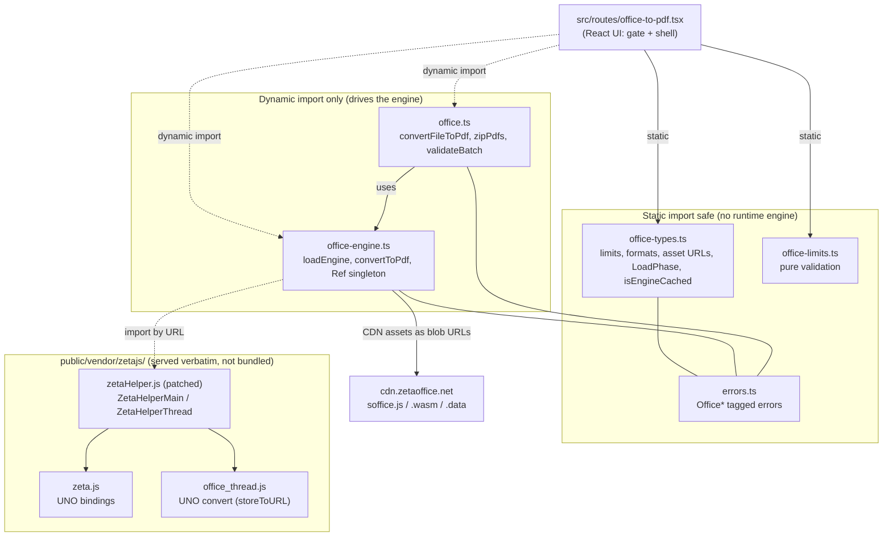
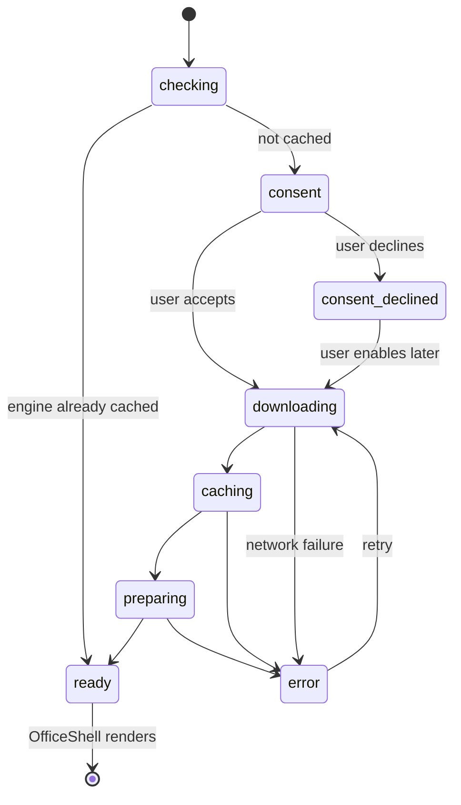
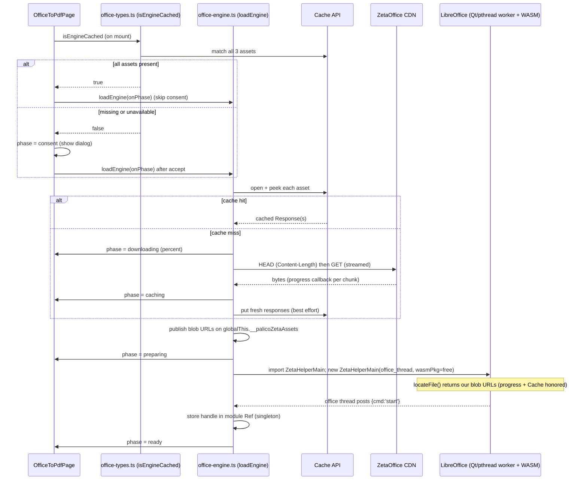
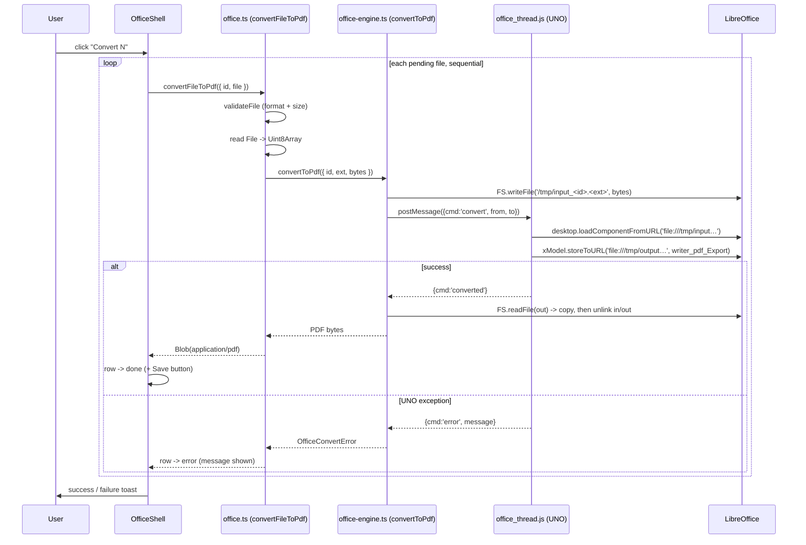

# Word to PDF

The Word to PDF tool converts office documents — Word (`.docx`, `.doc`),
OpenDocument (`.odt`), and Rich Text (`.rtf`) — into PDF entirely inside the
browser. No bytes leave the device. The heavy lifting runs on **LibreOffice
compiled to WebAssembly**, distributed by [ZetaOffice](https://zetaoffice.net/)
through the `zetajs` runtime.

This document explains the whole feature end to end: why we picked a full office
engine over lighter alternatives, the module layout, the engine load flow, the
conversion flow, the convert/download UX, the input guardrails, and the
LibreOffice integration details. It closes with the real problems we hit while
building it and how each was resolved.

## Table of contents

1. [Goals and constraints](#goals-and-constraints)
2. [Why ZetaOffice (LibreOffice WASM), and not the alternatives](#why-zetaoffice-libreoffice-wasm-and-not-the-alternatives)
3. [Module map](#module-map)
4. [High level architecture](#high-level-architecture)
5. [Engine load flow](#engine-load-flow)
6. [Conversion flow](#conversion-flow)
7. [Convert and download UX](#convert-and-download-ux)
8. [Input guardrails](#input-guardrails)
9. [ZetaOffice integration details](#zetaoffice-integration-details)
10. [Cross origin isolation (COOP / COEP)](#cross-origin-isolation-coop--coep)
11. [Error model](#error-model)
12. [Problems we faced](#problems-we-faced)
13. [Testing](#testing)
14. [File reference](#file-reference)

## Goals and constraints

- **Offline first.** The document is never uploaded. Conversion happens on
  device. Only the (generic, document-free) engine is fetched, once.
- **High fidelity.** The output must respect real page geometry: page breaks,
  headers/footers, tables, columns, fonts. An HTML-approximation would not be
  trustworthy enough to carry the product promise.
- **Format breadth.** `.docx`, `.doc`, `.odt`, and `.rtf` in, PDF out.
- **Lazy and gated.** The engine is roughly 53 MB. We never pull it into the
  route bundle and never download it until the user opts in. It is cached after
  the first load, so return visits are instant.
- **One instance, sequential.** LibreOffice runs as a single WASM instance with
  one virtual filesystem. Documents are converted one at a time. Running
  conversions in parallel would exhaust memory or corrupt the shared FS.
- **Bounded batch.** Per file 25 MB, at most 20 files, 100 MB combined.
- **Typed effects.** All logic outside the React layer uses Effect. Every
  failure is a tagged `Schema.TaggedError` on the Effect error channel. No raw
  throws, no swallowed errors.
- **Direction is one-way.** Office → PDF only. PDF → Word is intentionally out
  of scope (see the last subsection below).

## Why ZetaOffice (LibreOffice WASM), and not the alternatives

The engine choice is the single most important decision in this feature, so it
is worth recording in full. The requirement — **high-fidelity, multi-format,
fully client-side** conversion — rules out most of the field.

### The options we weighed

| Approach | Fidelity | Formats | Selectable text | Payload | Offline / no-upload |
| --- | --- | --- | --- | --- | --- |
| `mammoth.js` → HTML → `jsPDF` | Low | `.docx` only | Yes | ~hundreds of KB | Yes |
| `docx-preview` → `html2canvas` → `jsPDF` | Medium (visual) | `.docx` only | **No** (rasterized) | ~MBs | Yes |
| Server-side (Gotenberg / LibreOffice on a server, or a cloud API) | High | Everything | Yes | ~0 client | **No** |
| **ZetaOffice (LibreOffice WASM)** | **High** | `.docx/.doc/.odt/.rtf` (+xls/ppt) | Yes | **~53 MB (one-time, cached)** | **Yes** |

### Why the lighter client-side options fall short

- **`mammoth.js` → HTML → PDF** extracts *semantic* HTML (headings, paragraphs,
  basic tables) and renders that. It is tiny and keeps text selectable, but it
  throws away everything `mammoth` doesn't model: precise page geometry, headers
  and footers, multi-column layout, exact table widths, embedded fonts. The
  result reads as "the text of the document," not "the document." It is also
  `.docx`-only — it cannot open `.doc`, `.odt`, or `.rtf` at all.
- **`docx-preview` → `html2canvas` → PDF** renders a much more faithful DOM and
  then rasterizes it into the PDF. It *looks* close to Word, but the output is
  images: no selectable or searchable text, larger files, and fiddly multi-page
  pagination. Still `.docx`-only.

Neither can honor the fidelity or format-breadth goals. They are the right tool
for "show me roughly what's in this docx," not "convert this document to PDF."

### Why not server-side

A server (Gotenberg, a headless LibreOffice, or a hosted conversion API) is the
easy, high-fidelity answer — and it is exactly what the rest of the market does.
It is a non-starter here: it requires **uploading the user's document**, which
violates the product's core promise (offline-first, nothing leaves the device).
That single constraint eliminates every server option regardless of quality.

### Why ZetaOffice wins

ZetaOffice is **the actual LibreOffice layout engine** compiled to WebAssembly.
Conversion runs LibreOffice's real rendering pipeline via its UNO API
(`loadComponentFromURL` → `storeToURL` with the `writer_pdf_Export` filter), so
fidelity is essentially "what LibreOffice would produce on the desktop." It
opens `.docx`, `.doc`, `.odt`, `.rtf` (and more) because it *is* LibreOffice. And
it runs 100% on device — the document never leaves the browser.

**Pros**

- Real office layout engine → high fidelity (page geometry, tables, fonts,
  headers/footers), selectable text in the output PDF.
- Broad format support out of the box (`.doc` legacy binary included, which the
  JS-only libraries cannot read).
- Fully client-side; preserves the offline / no-upload guarantee.
- Actively maintained, published on npm (`zetajs`) with a public asset CDN.

**Cons (and how we mitigate them)**

- **~53 MB one-time download.** Mitigated by a consent gate + byte-progress
  download + **Cache API persistence**, so it is paid once and skipped on return
  visits — the same pattern the 31 MB video engine already uses.
- **Heavy boot.** LibreOffice's Qt runtime spins up (a few seconds on a warm
  cache). Mitigated by keeping the engine a singleton for the session.
- **Main-thread + DOM bound.** `ZetaHelperMain` needs a real `#qtcanvas` element
  and cannot run in our own Web Worker (it spawns LibreOffice's *own* pthread
  worker). We run it on the main thread with a hidden canvas.
- **Experimental API.** `zetajs` is explicitly "expect heavy API changes." We
  vendor a pinned copy and patch it locally rather than depend on unstable
  runtime behavior.
- **Requires cross-origin isolation.** Already satisfied site-wide for
  `ffmpeg.wasm`, so no new cost (see [Cross origin isolation](#cross-origin-isolation-coop--coep)).

The verdict: only a real office engine meets the fidelity and format goals, and
only a *client-side* one meets the offline goal. A ~53 MB gated, cached download
is an acceptable price for the one tool where conversion quality *is* the
product.

## Module map



The route imports only the dependency-free modules (`office-types.ts`,
`office-limits.ts`) at load time. The two modules that drive the engine
(`office-engine.ts`, `office.ts`) are reached only through `await import(...)`,
which keeps the engine out of the route chunk and lets the consent gate do its
job. The `zetajs` runtime itself is **not** an npm import in the shipped code —
it is vendored into `public/vendor/zetajs/` and loaded by URL (see
[integration details](#zetaoffice-integration-details) for why).

## High level architecture

The page has two visual states driven by a single `LoadPhase` value:

1. **Engine gate.** Before anything can convert, the engine must be present.
   `OfficeToPdfPage` checks the cache, may show a consent dialog, then drives the
   download / cache / prepare progress. A hidden `#qtcanvas` is mounted in every
   phase because LibreOffice's Qt runtime needs it to exist before boot.
2. **Conversion shell.** Once the phase reaches `ready`, `OfficeShell` renders
   the dropzone, the file queue, and the convert / download controls.



## Engine load flow

The engine is three assets fetched from the ZetaOffice CDN
(`https://cdn.zetaoffice.net/zetaoffice_latest/`):

| Asset          | Size     | Role                                    |
| -------------- | -------- | --------------------------------------- |
| `soffice.js`   | ~0.86 MB | Emscripten glue / bootstrap             |
| `soffice.wasm` | ~36.3 MB | LibreOffice compiled to WebAssembly     |
| `soffice.data` | ~15.9 MB | Packaged resources (fonts, configs, …)  |

They are cached in the Cache API under a versioned name
(`zetaoffice-wasm-free`) so switching CDN channels invalidates old entries.



Key points:

- **Singleton via `Ref`.** The loaded handle lives in a module-level
  `Ref.makeUnsafe<Option<EngineHandle>>`. This keeps the singleton inside the
  Effect graph instead of a hidden mutable variable, mirroring the video engine.
- **Download progress is aggregate.** We HEAD each missing asset for its
  `Content-Length`, sum them, then report a single percentage as bytes stream in.
- **Cache writes are best effort.** A quota error or private mode never blocks
  the conversion; the next visit re-downloads.
- **Blob-URL injection.** The prefetched (progress-tracked, cached) assets are
  turned into object URLs and published on `globalThis.__palicoZetaAssets`. The
  patched `zetaHelper.js` consults that map in `locateFile`, so LibreOffice loads
  *our* bytes instead of re-fetching from the CDN — that is how download progress
  and Cache-API persistence are grafted onto Emscripten's own loading (see
  [integration details](#zetaoffice-integration-details)).

## Conversion flow

When the user clicks **Convert**, the route converts every pending file
sequentially, streaming per-item status. Nothing is auto-downloaded.



Per file work in `convertFileToPdf`:

1. `validateFile` checks the supported format then the per-file size cap,
   mapping the pure `checkOfficeFile` result onto typed errors.
2. Read the `File` into bytes.
3. `convertToPdf` writes the bytes to LibreOffice's Emscripten FS at a canonical
   `/tmp/input_<id>.<ext>` path (the extension lets LibreOffice sniff the input
   type), posts a `convert` message, and awaits the reply. On success it copies
   the output bytes off the FS buffer and unlinks both files so a long batch
   can't accumulate memory.
4. The result is wrapped in a `Blob`.

Conversions are strictly sequential — the engine has one FS and one message
port, so `office-engine.ts` keeps a single `pendingConvert` slot and the route
loops with `await`.

## Convert and download UX

Conversion and download are **separate steps** (twin buttons), matching the
image converter:

1. **Convert N** converts every pending (fresh or previously-failed) file,
   streaming a per-item status badge: spinner → green check (done) → red alert
   (error). The button shows `Converting x / y` while running.
2. Each converted row gets a **Save** button to download that one PDF. When more
   than one file is converted, a **Download all (.zip)** button appears and
   bundles them into `converted-pdfs.zip`.

The zip is built **on demand** from the already-converted in-memory PDFs via
`office.ts`'s `zipPdfs` (fflate, stored / level 0 — PDFs barely compress), with
de-duplicated entry names (two `report.pdf` outputs → `report.pdf`,
`report-1.pdf`). A file that fails validation or conversion is marked on its row
and skipped; the rest of the batch still completes.

## Input guardrails

All pure validation lives in `office-limits.ts` and is unit tested; the Effect
layer maps the results onto typed errors.

### Supported formats

`SUPPORTED_OFFICE_EXTENSIONS` = `docx`, `doc`, `odt`, `rtf`. Validation is
extension-based (browser MIME types for these formats are inconsistent across
OSes). The dropzone's `accept` attribute is derived from the same list, so there
is one source of truth.

### Size and batch caps

Defined in `office-types.ts`. LibreOffice holds the whole document model in
memory while it renders, and a small compressed `.docx` can expand dramatically,
so the caps keep peak memory bounded. Because the batch converts sequentially,
peak ≈ one file rather than the whole queue.

| Guard          | Constant           | Value  | Error                        |
| -------------- | ------------------ | ------ | ---------------------------- |
| Per file       | `MAX_OFFICE_BYTES` | 25 MB  | `OfficeTooLargeError`        |
| Files per batch| `MAX_BATCH_FILES`  | 20     | `OfficeBatchTooLargeError`   |
| Combined batch | `MAX_BATCH_BYTES`  | 100 MB | `OfficeBatchTooLargeError`   |

Per-file format and size are checked at selection time (the file never enters
the queue if it fails). The batch caps are enforced when the queue grows and
before conversion.

## ZetaOffice integration details

### Why the runtime is vendored, not imported

`zetaHelper.js` resolves its sibling scripts (`zeta.js`) from its **own**
`import.meta.url`. If Vite bundled and hash-renamed it, that path math would
break. So the runtime (`zeta.js`, `zetaHelper.js`, plus our `office_thread.js`)
lives in `public/vendor/zetajs/` and is served **verbatim**. The `zetajs` npm
package is a `devDependency` only — the *source* we vendor from — and nothing in
`src/` imports it at runtime.

### The `office_thread.js` convert script

This module runs **inside LibreOffice's Emscripten pthread worker** (loaded via
`ZetaHelperMain` → `import(threadJs)`). It uses the UNO API:

```js
xModel = zHT.desktop.loadComponentFromURL(`file://${from}`, "_blank", 0, [hidden]);
xModel.storeToURL(`file://${to}`, [overwrite, { FilterName: "writer_pdf_Export" }]);
```

On success it posts `{cmd:'converted'}`; on a UNO exception it catches it and
posts `{cmd:'error', message}` so the app can surface a real, typed error
instead of a bare console log.

### Local patches to the vendored `zetaHelper.js`

Two small, documented patches (marked `PALICO PATCH` in the file):

1. **Robust module dir.** `modUrlDir` is computed as
   `new URL('.', import.meta.url).href` instead of the upstream string-chop,
   which mangled the `zeta.js` URL (see [problem 2](#2-mangled-zetajs-url)).
2. **Blob-URL asset override.** `locateFile`, `mainScriptUrlOrBlob`, and the
   `soffice.js` script tag prefer a URL from `globalThis.__palicoZetaAssets`
   before falling back to the CDN. This is the hook that lets us feed
   pre-fetched, progress-tracked, Cache-API-persisted assets to Emscripten. The
   patch is backwards compatible: with the map absent it behaves exactly like
   upstream (fetch from CDN).

### Serving the vendored runtime

The vendored JS must be served as ES modules under the site's COEP, in two
environments:

- **Production.** Cloudflare serves `public/vendor/*` statically;
  `public/_headers` tags `/vendor/*` with `COEP: require-corp` +
  `CORP: same-origin`, matching `/assets/*`.
- **Dev / preview.** Vite refuses to serve `publicDir` files as JS modules (they
  are excluded from the module graph → 500 "Failed to load url"). The
  `serveVendorStatic` plugin in `vite.config.ts` intercepts `/vendor/**` and
  streams it off disk with the right MIME + CORP header. Dev/preview only.

## Cross origin isolation (COOP / COEP)

LibreOffice's WASM uses `SharedArrayBuffer`, which is only available when the
page is cross-origin isolated:

```
Cross-Origin-Opener-Policy: same-origin
Cross-Origin-Embedder-Policy: require-corp
```

**This was already satisfied site-wide** for `ffmpeg.wasm` — `src/server.ts`
sets both headers on every SSR/worker response, and `vite.config.ts` mirrors
them for dev/preview. So this feature added no new isolation cost. The one
requirement was that the cross-origin CDN assets load under `require-corp`: the
ZetaOffice CDN sends `access-control-allow-origin: *` **and**
`cross-origin-resource-policy: cross-origin`, which satisfies it. The only
addition was the `/vendor/*` rule in `public/_headers` for the same-origin
vendored scripts.

## Error model

All failures are tagged errors in `errors.ts`:

- `OfficeUnsupportedFormatError`: the file's extension isn't one we convert.
- `OfficeTooLargeError`: a single file exceeds the per-file byte cap.
- `OfficeBatchTooLargeError`: the batch exceeds the file-count or combined-size
  cap.
- `OfficeEngineLoadError`: a failure during download / caching / preparing, with
  a `stage` field so the UI stays oriented.
- `OfficeEngineNotLoadedError`: conversion was requested before the engine
  finished loading.
- `OfficeConvertError`: LibreOffice failed to load or store the document (bad or
  corrupt input, unsupported feature, OOM, or an aborted office thread).
- `OfficeZipError`: bundling the converted PDFs failed.

Two convenience unions group them: `OfficeValidationError` (pre-conversion) and
`OfficeConversionError` (during conversion). Per-file failures are captured per
row so one bad document never aborts the batch.

## Problems we faced

These are the real issues we hit, in the order they surfaced.

### 1. Vite refused to serve the vendored runtime

The dynamic `import("/vendor/zetajs/zetaHelper.js")` returned a 500 ("Failed to
load url") in dev. Root cause: Vite excludes `publicDir` files from the module
graph, so they cannot be `import()`ed through the dev transform pipeline. In
production the Cloudflare static host serves them fine, but dev needs help. The
fix was the `serveVendorStatic` Vite plugin, which intercepts `/vendor/**`
*before* Vite's transform middleware and streams the file off disk with the
right MIME and CORP header.

### 2. Mangled `zeta.js` URL

With the runtime served, LibreOffice's worker failed to `importScripts` a
uno-script at `.../vendor/zetajs/zetaHelzeta.js` — a mangled path. Root cause:
`zetaHelper.js` derived its module directory by string-chopping
`import.meta.url` (`url.slice(0, url.length - 'zetaHelper.js'.length)`), which
produced the wrong prefix. The fix was a local patch to compute it as
`new URL('.', import.meta.url).href`, which is robust to query strings and path
shape.

### 3. `Cannot read properties of null (reading 'addEventListener')`

The engine crashed at boot on the real route (but not the throwaway prototype).
`ZetaHelperMain`'s constructor does
`document.getElementById('qtcanvas').addEventListener(...)`; the real route only
rendered the canvas inside the *ready* shell, but the engine boots during the
*gate* phase, so the element didn't exist yet. The fix was to hoist a hidden
`#qtcanvas` into `OfficeToPdfPage` so it is mounted in every phase.

### 4. Download progress and caching vs Emscripten's own fetch

Unlike `ffmpeg.wasm` (which takes explicit `coreURL` / `wasmURL` blob URLs),
LibreOffice fetches `soffice.wasm` / `soffice.data` itself via Emscripten's
`locateFile`. That meant our video-style "download %, cache, skip next visit"
UX had nowhere to hook in. The fix was the blob-URL injection: we pre-fetch the
three assets with byte progress into the Cache API, publish object URLs on
`globalThis.__palicoZetaAssets`, and patch `locateFile` to prefer them. Progress
and persistence now work exactly like the video engine, and the patch degrades
gracefully to a plain CDN fetch when the map is absent.

### 5. Confirming the engine is not in the route bundle

The engine is large, and pulling it into the route chunk would defeat the
consent gate. The engine-touching modules (`office-engine.ts`, `office.ts`) are
reached only through `await import(...)` in user-gesture handlers. The
production build confirms `office-engine` lands in its own chunk, separate from
the route chunk, and the vendored files ship to `dist/client/vendor/zetajs/`.

## Testing

Pure logic is unit tested in `src/lib/file/office-limits.test.ts`:

- `officeExtension`: extension parsing, case-folding, and the no-extension case.
- `isSupportedOffice`: the four supported formats vs. unsupported / bare names.
- `checkOfficeFile`: format-before-size ordering and the per-file cap boundary.
- `checkOfficeBatch`: the file-count and combined-size caps, and their ordering.

Run them with `bun run test`. The engine and conversion paths depend on a real
browser, Qt, and WASM, so they are validated in `bun run dev` (a real `.docx`
converts to a valid `%PDF-1.7`, and a `.docx` + `.rtf` batch bundles into a zip
with de-duplicated names).

## File reference

| File                                  | Responsibility                                                                 |
| ------------------------------------- | ------------------------------------------------------------------------------ |
| `src/routes/office-to-pdf.tsx`        | UI: engine gate, hidden canvas, dropzone, convert + download controls          |
| `src/lib/file/office-types.ts`        | Limits, formats, CDN asset descriptors, `LoadPhase`, `isEngineCached`          |
| `src/lib/file/office-limits.ts`       | Pure validation (`checkOfficeFile`, `checkOfficeBatch`, extension helpers)      |
| `src/lib/file/office-engine.ts`       | `loadEngine`, `convertToPdf`, `Ref` singleton, prefetch + Cache + blob inject   |
| `src/lib/file/office.ts`              | `convertFileToPdf`, `zipPdfs`, `validateBatch`                                  |
| `src/lib/file/errors.ts`              | `Office*` tagged errors and the two unions                                      |
| `src/lib/file/office-limits.test.ts`  | Unit tests for the pure guardrail logic                                         |
| `public/vendor/zetajs/zetaHelper.js`  | Vendored + patched ZetaHelperMain / ZetaHelperThread                            |
| `public/vendor/zetajs/zeta.js`        | Vendored UNO bindings                                                           |
| `public/vendor/zetajs/office_thread.js` | UNO convert script (runs in LibreOffice's worker)                            |
| `public/_headers`                     | COEP/CORP for `/vendor/*` (production)                                          |
| `vite.config.ts`                      | `serveVendorStatic` plugin + COOP/COEP for dev/preview                          |
| `src/server.ts`                       | COOP/COEP headers for production responses (shared, pre-existing)              |
