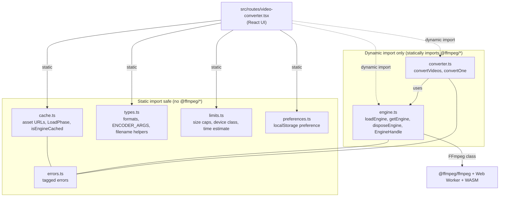
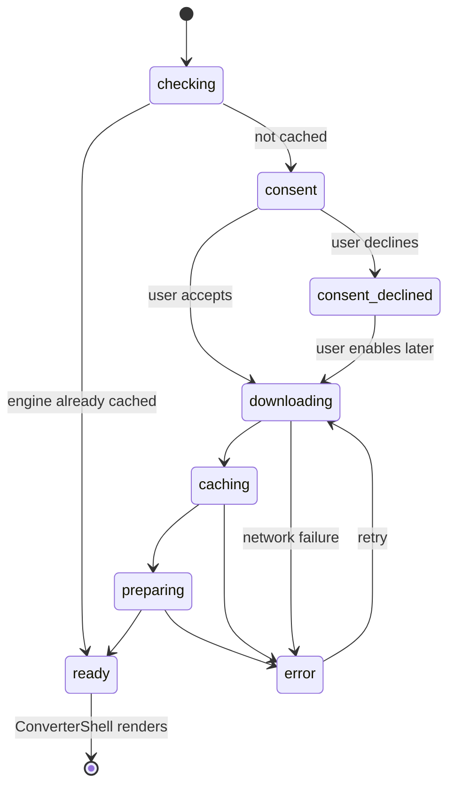
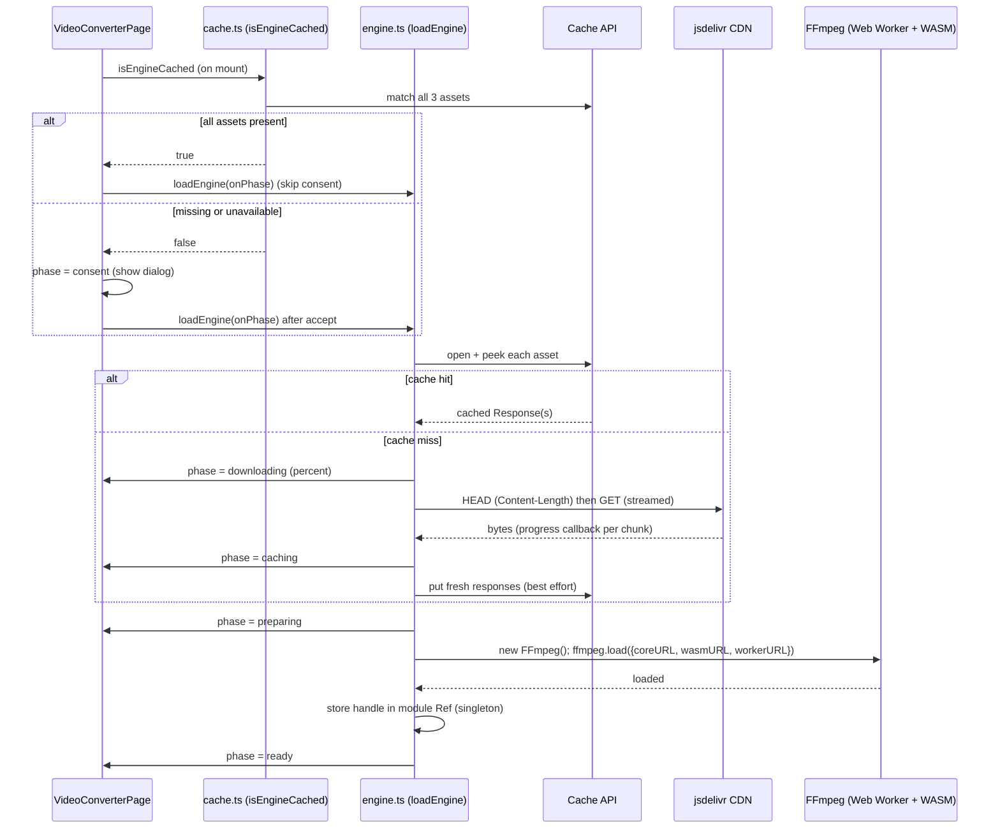
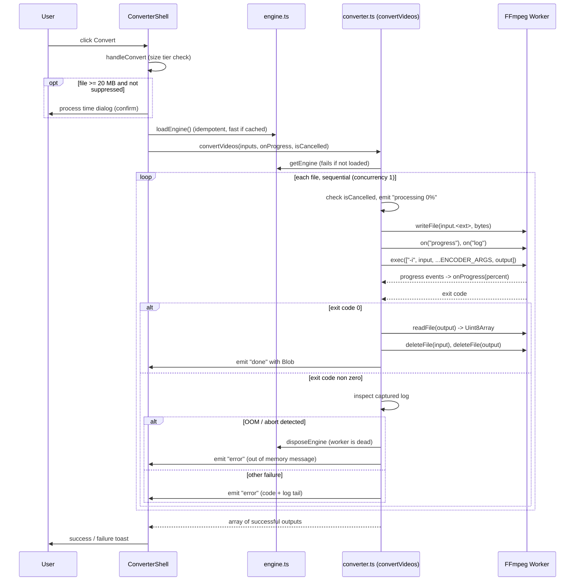
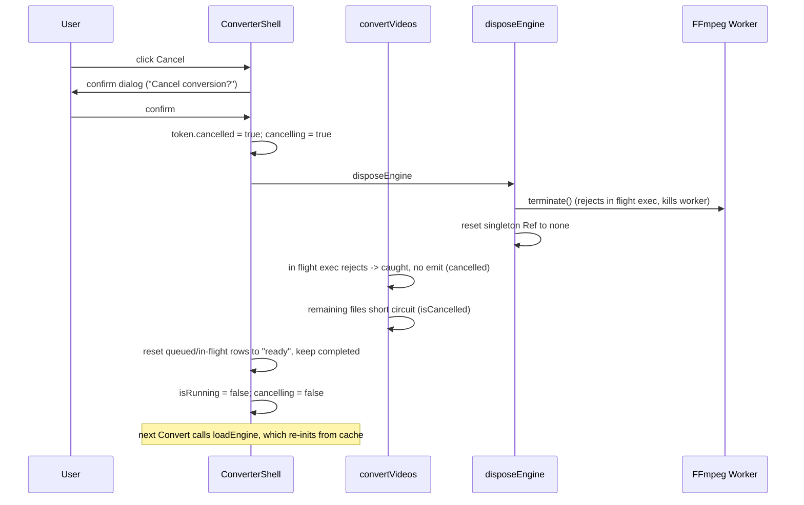
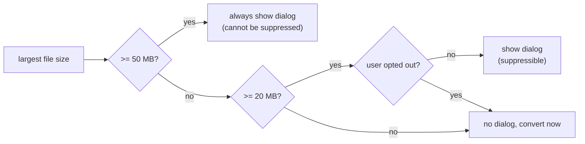

# Video Converter

The video converter turns a video file into another container/codec (MP4, WebM,
MOV, MKV, or AVI) entirely inside the browser. No bytes leave the device. All of
the heavy lifting runs on `ffmpeg.wasm`, a WebAssembly build of FFmpeg, executed
inside a Web Worker.

This document explains the whole feature end to end: the module layout, the
engine load flow, the conversion flow, the input guardrails, cancellation, and
the integration details with FFmpeg. It closes with the real problems we hit
while building it and how each was resolved.

## Table of contents

1. [Goals and constraints](#goals-and-constraints)
2. [Module map](#module-map)
3. [High level architecture](#high-level-architecture)
4. [Engine load flow](#engine-load-flow)
5. [Conversion flow](#conversion-flow)
6. [Cancellation and worker lifecycle](#cancellation-and-worker-lifecycle)
7. [Input guardrails](#input-guardrails)
8. [FFmpeg integration details](#ffmpeg-integration-details)
9. [Cross origin isolation (COOP / COEP)](#cross-origin-isolation-coop--coep)
10. [Error model](#error-model)
11. [Problems we faced](#problems-we-faced)
12. [Testing](#testing)
13. [File reference](#file-reference)

## Goals and constraints

- **Offline first.** The file is never uploaded. Conversion happens on device.
- **Lazy and gated.** The FFmpeg engine is roughly 31 MB. We never pull it into
  the route bundle and we never download it until the user opts in.
- **One instance, sequential.** `ffmpeg.wasm` is a single shared worker with one
  virtual filesystem and one progress channel. Files are converted one at a time
  (`concurrency: 1`). Running encodes in parallel would either exhaust memory or
  interleave progress events.
- **Bounded batch.** The queue is capped at `MAX_FILES` (5). Because conversion
  is sequential and every finished output blob is retained until download, a
  large queue means a long wait and growing memory, so the cap keeps the worst
  case in check.
- **Typed effects.** All logic outside the React layer uses Effect. Every failure
  is a tagged `Schema.TaggedError` surfaced on the Effect error channel. No raw
  throws, no swallowed errors.
- **No `@ffmpeg/*` in the initial bundle.** Modules that statically import FFmpeg
  are only reached through `await import(...)` inside a user gesture.

## Module map



The split into "static import safe" and "dynamic import only" is deliberate. The
route needs constants like the asset URLs, the `LoadPhase` type, and the format
list at module load time, so those live in dependency free modules. The two
modules that statically import `@ffmpeg/*` are reached only through dynamic
import, which is what keeps the 31 MB engine out of the route chunk and lets the
consent gate do its job.

## High level architecture

The page has two visual states driven by a single `LoadPhase` value:

1. **Engine gate.** Before anything can convert, the engine must be present.
   `VideoConverterPage` checks the cache, may show a consent dialog, then drives
   the download/cache/prepare progress.
2. **Converter shell.** Once the phase reaches `ready`, `ConverterShell` renders
   the dropzone, the queue, the format picker, the convert button, and the cancel
   controls.



## Engine load flow

The engine is three assets fetched from a CDN: the core JavaScript glue, the WASM
binary, and the worker script. They are cached in the Cache API under a versioned
name (`ffmpeg-wasm-v0.12.10`) so a version bump invalidates old entries naturally.



Key points:

- **Singleton via `Ref`.** The loaded handle lives in a module level
  `Ref.makeUnsafe<Option<EngineHandle>>`. Every read goes through `getEngine`,
  which fails with `EngineNotLoadedError` when the option is `none`. This keeps
  the singleton inside the Effect graph instead of a hidden mutable variable.
- **Download progress is aggregate.** We HEAD each missing asset for its
  `Content-Length`, sum them, then report a single percentage as bytes stream in.
- **Cache writes are best effort.** A quota error or private mode never blocks the
  conversion. The engine still works for the session; the next visit re-downloads.
- **Blob URLs.** Each cached or fetched `Response` is turned into an object URL
  and handed to `ffmpeg.load({ coreURL, wasmURL, workerURL })`.

## Conversion flow

When the user clicks Convert, the route may first show the process time dialog
(see [Input guardrails](#input-guardrails)), then calls `runConversion`, which
loads the engine if needed and runs the batch.



Per file work happens in `convertOne`:

1. Read the `File` into bytes with `file.arrayBuffer()`.
2. Write the bytes to the FFmpeg virtual filesystem as `input.<ext>`.
3. Subscribe to the `progress` and `log` events for the lifetime of this exec.
   This is wrapped in `Effect.acquireUseRelease` so both listeners are always
   removed, even on failure. That prevents a later file's events from bleeding
   into this row's progress bar.
4. Run `ffmpeg.exec(["-i", input, ...ENCODER_ARGS[format], output])`.
5. On a clean exit, read the output, delete the virtual files (best effort), and
   wrap the bytes in a `Blob`.
6. On a non zero exit, classify the failure (see [Error model](#error-model)).

The batch is driven by `Effect.forEach(..., { concurrency: 1 })`. Each file is
wrapped in `Effect.result` so one bad input never aborts the whole batch. The
final result is the list of successful outputs only.

## Cancellation and worker lifecycle

`ffmpeg.wasm` exposes `terminate()`, which rejects every in flight call and then
kills the worker. There is no way to stop an encode mid frame other than killing
the worker, and once terminated the `FFmpeg` instance is dead and must be rebuilt.

We use a cancellation token plus terminate, not fiber interruption, because
`terminate()` rejects the in flight `exec` promise cleanly (the `Effect.tryPromise`
catch turns it into a typed error), which avoids orphaned promise rejections.



Design notes:

- **The token is a mutable object held in a ref.** A fresh token is created per
  run and captured by both the `isCancelled` closure passed to `convertVideos`
  and the cancel handler, so they share the same object.
- **Completed downloads survive.** Cancelling resets `processing` and `ready`
  rows back to `ready` but keeps `done` rows so their output blobs stay
  downloadable.
- **The button is disabled during the terminate window** (`cancelling` state),
  and `disposeEngine` is a no op when the singleton is already empty, so mashing
  Cancel cannot double terminate.
- **Recovery is lazy.** After cancel (or after an OOM, see below) the singleton
  is `none`. The next `runConversion` calls `loadEngine`, which is idempotent and
  re-inits from the Cache API, so the next conversion starts fresh and fast.

## Input guardrails

Before a file enters the queue and before a conversion starts, three guardrails
protect the user from a tool that would otherwise hang or crash on huge inputs.
All of the pure logic lives in `limits.ts` and is unit tested.

### Size caps

The cap depends on device class. Mobile gets lower limits because iOS Safari and
Android Chrome are tighter on memory.

| Device  | Warn at | Hard cap |
| ------- | ------- | -------- |
| Desktop | 200 MB  | 500 MB   |
| Mobile  | 100 MB  | 200 MB   |

- Over the hard cap: the file is rejected at selection time with a clear message
  that includes the memory hint. It never enters the queue, so no engine work is
  triggered.
- Over the warn threshold but under the cap: the file is accepted with a soft
  toast that warns it may take several minutes.

### Batch count cap

The queue accepts at most `MAX_FILES` (5) videos. When a selection would push the
queue past the cap, the overflow is dropped and the user sees "You can convert up
to 5 videos at a time." This mirrors the image tools (which cap at 10) but is set
lower because video conversion is sequential and the output blobs accumulate.

### Device classification

`classifyDevice({ userAgent, viewportWidth })` returns `mobile` if the user agent
matches a phone/tablet pattern OR the viewport is narrower than 768 px. It is a
pure function; the route reads `navigator.userAgent` and `window.innerWidth` and
passes them in. Using both signals (not user agent alone) is the conservative
choice, since the lower mobile caps are the safer memory budget.

### Process time warning dialog

Conversions are slow, so we set expectations before starting. The dialog tier is
based on the largest queued file:



The dialog estimates the time from file size and the chosen codec
(`estimateMinutes`). The "do not show again for files under 50 MB" checkbox writes
a flag to `localStorage` through `preferences.ts`. Files at or above 50 MB always
warn regardless of that preference, because those are the genuinely slow jobs the
user needs to know about.

## FFmpeg integration details

### Why `core-mt`

We use the multi threaded build `@ffmpeg/core-mt`. The single threaded core runs
at roughly 10 to 20 times slower than realtime, which is unusable for the file
sizes this tool targets. Multi threading requires `SharedArrayBuffer`, which
requires the page to be cross origin isolated (see the next section).

### The `EngineHandle` abstraction

`converter.ts` never imports the `FFmpeg` class as a value. Instead `engine.ts`
exposes a structural interface, `EngineHandle`, with just the methods we use:
`readFile`, `writeFile`, `deleteFile`, `exec`, and `on` / `off` for the
`progress` and `log` events. This keeps `converter.ts` free of a value level
`@ffmpeg/*` dependency at the type position and makes the contract explicit.

### Encoder presets

Per format argument lists live in `ENCODER_ARGS` in `types.ts`. The pipeline
prepends `-i <input>` and appends the output filename; everything in between
comes from this table.

- **MP4 / MOV / MKV:** H.264 (`libx264`) plus AAC audio. Broadest playback
  compatibility. The video settings are tuned for memory, not the smallest file:
  `-preset veryfast`, `-crf 23`, `-threads 2`. See the OOM problem below for why.
- **WebM:** VP8 (`libvpx`) plus Opus. VP8, not VP9: `libvpx-vp9` hard-aborts
  under `@ffmpeg/core-mt`'s threading (crashes within a few frames), while
  `libvpx` (VP8) is lighter and stable in wasm.
- **AVI:** MPEG-4 ASP plus MP3, for the tooling that still asks for AVI.

### Filenames in the virtual filesystem

`inputExtension` guesses a sensible extension for the in FFmpeg input file from
the source name or MIME type. `outputFileName` strips the old extension and
appends the new one for the downloaded file. FFmpeg auto detects the container
from content, but a sensible extension helps with edge cases.

### Progress and logs

The worker forwards two event streams. `progress` gives a 0 to 1 ratio that we
round to a percent for the per row progress bar. `log` carries FFmpeg's stdout and
stderr. We keep a rolling buffer of the last 64 log lines during each exec; on a
failure we append the tail to the error message so the real reason is visible.

## Cross origin isolation (COOP / COEP)

`SharedArrayBuffer`, and therefore the multi threaded core, is only available when
the page is cross origin isolated. That requires two response headers on the
document and on the scripts it spawns:

```
Cross-Origin-Opener-Policy: same-origin
Cross-Origin-Embedder-Policy: require-corp
```

We set these in two places, depending on environment:

1. **Production — `public/_headers`.** The site deploys as a static SPA with no
   rendering Worker (see problem 6), so there is no server response to attach
   headers to. Cloudflare's `_headers` file supplies them instead:
   - `/*` → `COOP: same-origin` + `COEP: require-corp` on the HTML document
     (applied to every prerendered page and `404.html`, which are all static files).
   - `/assets/*` and `/vendor/*` → `COEP: require-corp` + `CORP: same-origin`, so
     the bundled workers (image converter, ffmpeg internals) and the ZetaOffice
     runtime load under the cross-origin-isolated document rather than being
     blocked with `ERR_BLOCKED_BY_RESPONSE`.

   `src/server.ts` still sets these headers, but in production it is only the
   build/prerender entry (via `wrangler.jsonc` `main`) — its response never
   reaches the browser, because the deploy ships `dist/client` as static assets.
2. **Dev and preview — `vite.config.ts`.** Sets them through `server.headers`
   and `preview.headers`. This matters because Vite serves the `@ffmpeg/ffmpeg`
   internal worker (`worker.js?worker_file&type=module`) from its own middleware,
   which does not pass through `src/server.ts`. Without these the nested worker
   cannot spawn and `ffmpeg.load()` hangs (see the problems below).

## Error model

All failures are tagged errors defined in `errors.ts`:

- `EngineNotLoadedError`: `getEngine` was called before the engine loaded.
- `EngineLoadError`: a failure during download, caching, or preparing, with a
  `stage` field so the UI stays oriented.
- `VideoDecodeError`: could not read the source file bytes.
- `VideoEncodeError`: a failure staging, encoding, or reading the output, with the
  `fileName` and the target `format`.

`convertVideos` returns `Effect<readonly ConvertVideoOutput[], EngineNotLoadedError>`.
The engine missing case is the only error that aborts the batch; per file decode
and encode failures are captured with `Effect.result` and reported per row.

When `exec` returns a non zero code, the pipeline inspects the captured log:

- If the log shows an emscripten abort or out of memory, the worker is dead, so we
  call `disposeEngine` (forcing a fresh re-init on the next run) and surface a
  friendly out of memory message.
- Otherwise we surface the exit code plus the tail of the log.

## Problems we faced

These are the real issues we hit, in the order they surfaced.

### 1. Custom server entry was ignored

We needed the COOP and COEP headers on the SSR HTML. The `@cloudflare/vite-plugin`
generates a worker entry that re-exports from `wrangler.jsonc`'s `main`, which
overrides TanStack Start's own `src/server.ts` auto detection. A `public/_headers`
file did not help because it only applies to static asset responses, not the SSR
HTML. The fix was to point `wrangler.jsonc` `main` directly at `src/server.ts` so
our custom entry that injects the headers is actually used.

### 2. Engine stuck on "Preparing tools" in dev

After the consent dialog the engine downloaded, but the flow froze at the
preparing stage. The console showed a COEP error pointing at
`worker.js?worker_file&type=module`. Root cause: the headers in `src/server.ts`
only cover the worker and SSR handler, but in dev and preview Vite's own
middleware serves the `@ffmpeg/ffmpeg` worker directly, without those headers. A
multi threaded core spawns nested workers, which requires the worker script itself
to be served in a cross origin isolated context. The fix was to add
`server.headers` and `preview.headers` in `vite.config.ts` so Vite attaches COOP
and COEP to every response, including the worker.

### 3. "Encoder exited with code -1" with no detail

The first conversion failed with a bare exit code. `ffmpeg.ret` defaults to -1 and
is only set on a clean `main()` exit, so -1 means the core aborted before exiting.
The pipeline was discarding FFmpeg's log output, so the reason was invisible. The
fix was to expose the `log` event on `EngineHandle`, capture a rolling buffer of
recent lines during each exec, and append the tail to the `VideoEncodeError`. This
turned an opaque code into an actionable message and stays as a permanent
diagnostic.

### 4. Out of memory on high resolution video

With the log captured, the real error appeared: `Aborted(OOM)`, failing at the
very first frame. `core-mt` has a fixed WASM memory ceiling that cannot be raised
at runtime, and a 4K input under heavier settings blew past it immediately. Two
changes addressed it:

- Reduce the encoder's memory footprint. We switched H.264 from `-preset medium`
  to `-preset veryfast` (which drops the reference frames and lookahead buffers
  that dominate memory) and added `-threads 2` (auto threading otherwise
  multiplies the per thread frame buffers by the core count).
- Handle OOM gracefully. An emscripten abort leaves the worker permanently dead,
  so we detect the abort in the log, call `disposeEngine` so the next conversion
  re-inits a fresh worker, and show an honest message suggesting a shorter clip or
  a lower resolution. Without disposing, the tool was bricked until a page reload.

A browser based transcoder cannot convert arbitrarily large video. These changes
widen the set of inputs that succeed and make the inevitable ceiling fail cleanly
rather than hang.

### 5. Keeping the engine out of the route bundle

The engine is large, and pulling it into the route chunk would defeat the consent
gate and slow the initial load. We split the FFmpeg touching modules
(`engine.ts`, `converter.ts`) from the dependency free ones and reach the former
only through `await import(...)` inside user gesture handlers. The production
build confirms `engine` and `converter` land in their own chunks, separate from
the route chunk.

### 6. Worker bundle exceeded Cloudflare's size limit (SSR → static SPA)

Problem 1's fix (custom `src/server.ts` entry for the SSR headers) worked, but
the SSR Worker bundled every client-only library — transformers, mermaid, pdf.js,
and ffmpeg glue — pushing the deployed script past Cloudflare's 3 MiB free-plan
limit (`code: 10027`). This app renders everything client-side, so SSR bought us
nothing but bundle weight. The fix was to drop the rendering Worker entirely:

- `vite.config.ts` enables SPA mode (`tanstackStart({ spa: … })`), prerendering
  a static shell. Production now also prerenders every page, see
  [seo.md](seo.md).
- `wrangler.deploy.jsonc` is an assets-only config (no `main`) pointing at
  `dist/client`; static assets have no size limit. `bun run deploy` targets it.
- With no server response to carry them, the document COOP/COEP headers moved to
  `public/_headers` (see the cross-origin isolation section).

Never run bare `wrangler deploy` — it uses `wrangler.jsonc` (`main: src/server.ts`)
and re-triggers the 25 MB Worker upload. Only `bun run deploy` is safe.

### 7. Vitest could not load the app config

The project's `test` script existed but had no tests, so it was never exercised.
When the first test arrived, Vitest choked on the Cloudflare and TanStack Start
plugins in `vite.config.ts` ("depsOptimizer is required in dev mode"). The fix was
a dedicated `vitest.config.ts` with a plain node environment that does not load
those plugins, since the unit tests target pure modules.

## Testing

Pure logic is unit tested in `src/lib/video/limits.test.ts`:

- `classifyDevice`: desktop versus mobile user agents, the narrow viewport
  heuristic, and the 768 px boundary.
- `checkFileSize`: the warn and hard cap boundaries for both device classes.
- `estimateMinutes`: the one minute floor and the relative codec ordering.
- `processTimeWarningLevel`: the 20 MB and 50 MB tier boundaries.

Run them with `bun run test`. The engine and conversion paths depend on a real
browser worker and WASM, so they are validated manually in `bun run dev`.

## File reference

| File                                | Responsibility                                                            |
| ----------------------------------- | ------------------------------------------------------------------------- |
| `src/routes/video-converter.tsx`    | UI: engine gate, queue, convert and cancel controls, dialogs              |
| `src/lib/video/cache.ts`            | Asset URLs, cache name, `LoadPhase`, `isEngineCached` (no `@ffmpeg/*`)     |
| `src/lib/video/engine.ts`           | `loadEngine`, `getEngine`, `disposeEngine`, `EngineHandle` (static FFmpeg) |
| `src/lib/video/converter.ts`        | `convertVideos`, `convertOne`, progress and log handling (static FFmpeg)   |
| `src/lib/video/types.ts`            | Formats, `ENCODER_ARGS`, filename helpers                                 |
| `src/lib/video/limits.ts`           | Size caps, batch count cap, device classification, time estimate, tiers   |
| `src/lib/video/preferences.ts`      | `localStorage` backed "do not show again" preference                      |
| `src/lib/video/errors.ts`           | Tagged errors for the engine and pipeline                                 |
| `src/lib/video/limits.test.ts`      | Unit tests for the pure guardrail logic                                   |
| `public/_headers`                   | Production COOP/COEP (document + `/assets/*`, `/vendor/*`) for the SPA     |
| `src/server.ts`                     | Build/prerender entry; sets COOP/COEP (unused by the static prod deploy)   |
| `wrangler.deploy.jsonc`             | Assets-only deploy config (`dist/client`); `bun run deploy` targets it     |
| `vite.config.ts`                    | SPA mode + COOP/COEP headers for dev and preview                          |
