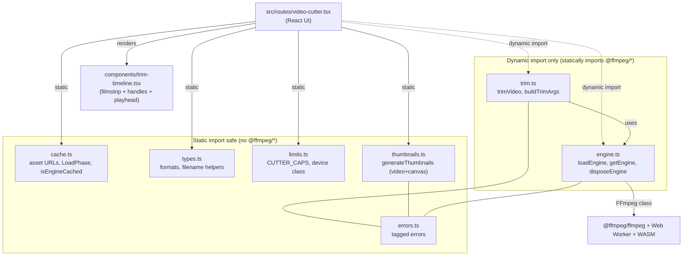
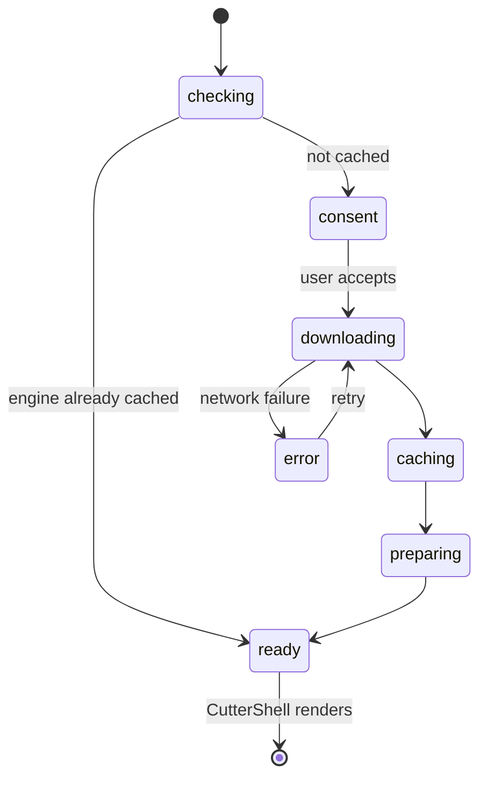
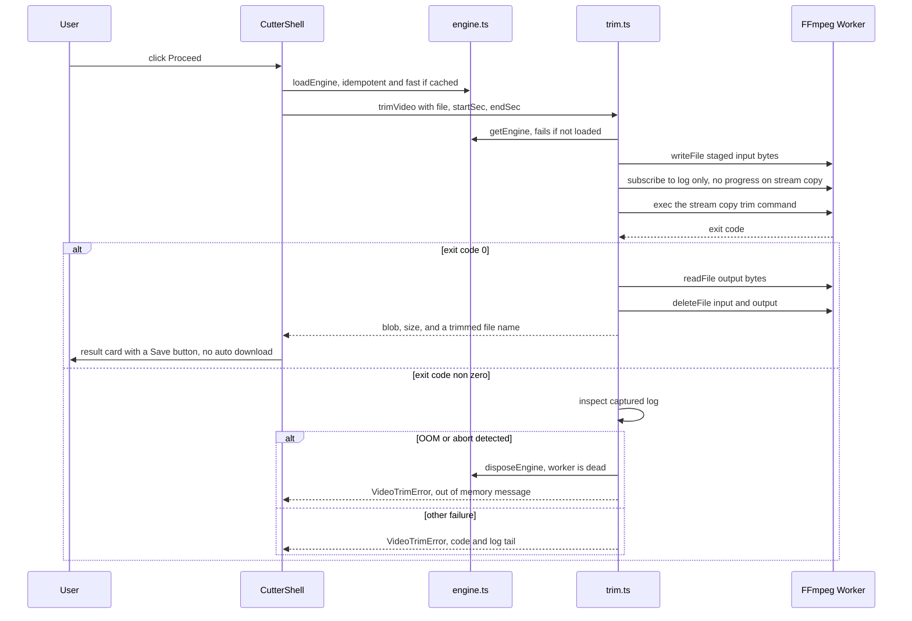
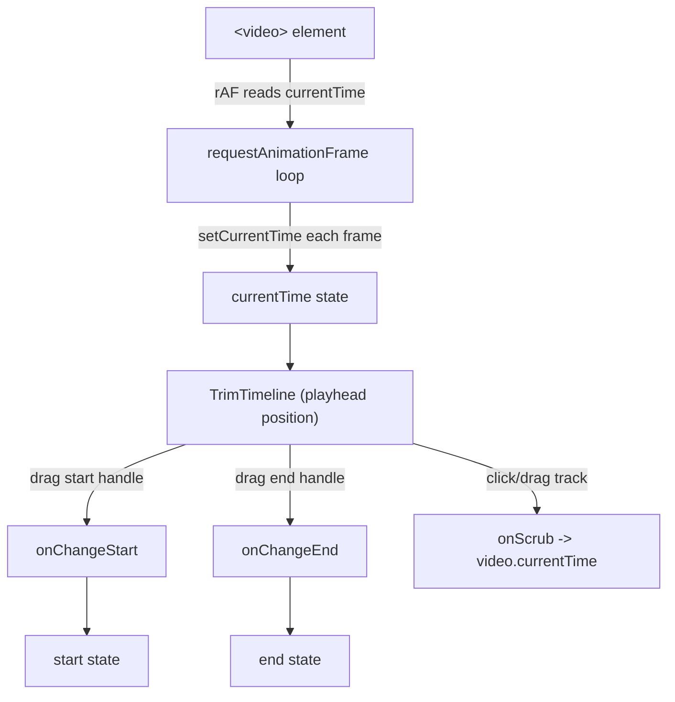
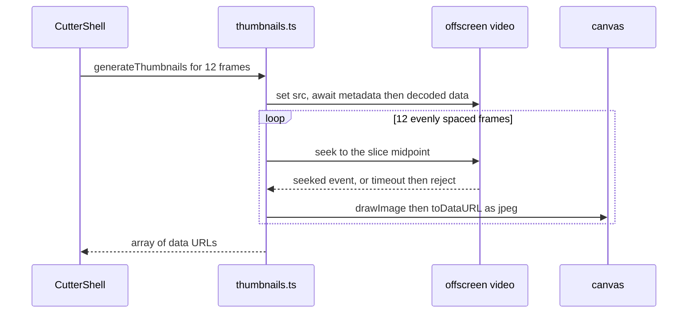
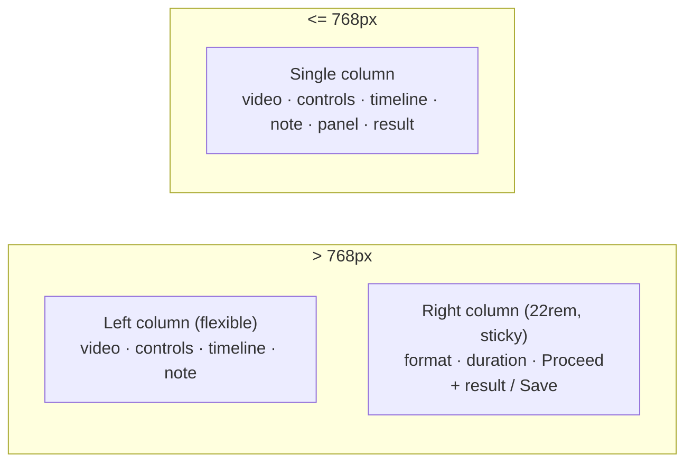

# Video Cutter

The video cutter trims a clip out of a single video — pick a start and end on a
timeline, preview it, and export the selection — entirely inside the browser. No
bytes leave the device. Like the [video converter](./video-converter.md), the
heavy lifting runs on `ffmpeg.wasm`. Unlike the converter, the cutter never
re-encodes: it copies the existing streams (`-c copy`), so a trim is near
instant, lossless, and light on memory, and the output keeps the input's format.

This document explains the whole feature end to end: the module layout, how it
reuses the converter's engine, the trim flow, the preview and timeline, the input
guardrails, cancellation, and the FFmpeg details that stream copy implies. It
closes with the real problems we hit while building it and how each was resolved.

## Table of contents

1. [Goals and constraints](#goals-and-constraints)
2. [Module map](#module-map)
3. [High level architecture](#high-level-architecture)
4. [Engine load flow (shared)](#engine-load-flow-shared)
5. [Trim flow](#trim-flow)
6. [Preview, playhead, and the timeline](#preview-playhead-and-the-timeline)
7. [Filmstrip thumbnails](#filmstrip-thumbnails)
8. [Cancellation and worker lifecycle](#cancellation-and-worker-lifecycle)
9. [Input guardrails](#input-guardrails)
10. [FFmpeg integration details](#ffmpeg-integration-details)
11. [Responsive layout](#responsive-layout)
12. [Error model](#error-model)
13. [Problems we faced](#problems-we-faced)
14. [Testing](#testing)
15. [File reference](#file-reference)

## Goals and constraints

- **Offline first.** The file is never uploaded. Trimming happens on device.
- **Stream copy, not re-encode.** The cut is `-ss <start> -i <input> -t
  <duration> -c copy`. There is no decode/encode pass, so it finishes in a beat,
  loses no quality, and the output container equals the input container. The
  trade-off is keyframe snapping (see [FFmpeg details](#ffmpeg-integration-details)).
- **Output format follows input.** There is no format picker. We accept the same
  five containers the converter supports (MP4, WebM, MOV, MKV, AVI) and write the
  trimmed clip back into the same one.
- **Single video at a time.** The cutter is a focused single-file editor (preview
  + timeline), not a batch queue. There is no `MAX_FILES`.
- **Reuse the engine.** The cutter shares the converter's engine loader, Cache API
  gate, `LoadPhase`, device/size limits, and cancellation pattern. If the user
  already downloaded the ~31 MB engine (e.g. via the converter), the cutter skips
  the consent dialog entirely.
- **Typed effects.** All logic outside the React layer uses Effect. Every failure
  is a tagged `Schema.TaggedError`. No raw throws, no swallowed errors.
- **No `@ffmpeg/*` in the initial bundle.** The one module that statically imports
  FFmpeg (`trim.ts`) is reached only through `await import(...)` inside a user
  gesture, exactly like `engine.ts` / `converter.ts`.

## Module map

The same "static import safe" versus "dynamic import only" split as the converter
applies. The new modules are `trim.ts` (the stream-copy pipeline — dynamic import
only, because it statically imports the engine), `thumbnails.ts` (filmstrip
extraction — pure DOM, no FFmpeg, so it is safe to static import and runs the
moment a file is picked), and the `trim-timeline.tsx` component. Everything
under `cache.ts`, `engine.ts`, and the bulk of `limits.ts` / `types.ts` /
`errors.ts` is shared with the converter.

## High level architecture

The page has two visual states driven by the shared `LoadPhase` value:

1. **Engine gate.** Identical to the converter: check the cache, maybe show the
   consent dialog (with a scissors icon and cutter copy), then drive the
   download/cache/prepare progress. If the engine is already cached the dialog is
   skipped.
2. **Cutter shell.** Once the phase reaches `ready`, `CutterShell` renders the
   dropzone; after a file is chosen it shows the preview, playback controls, the
   trim timeline, and the format/duration/proceed panel.

## Engine load flow (shared)

The cutter does not reimplement engine loading. It calls the same `loadEngine` /
`getEngine` / `disposeEngine` from `engine.ts` and the same `isEngineCached` from
`cache.ts`, so the three-asset CDN fetch, the versioned Cache API storage
(`ffmpeg-wasm-v0.12.10`), the aggregate download percentage, and the singleton
`Ref<Option<EngineHandle>>` all behave exactly as documented in
[video-converter.md → Engine load flow](./video-converter.md#engine-load-flow).

The only cutter-specific behavior is the consequence of that shared cache: a user
who already downloaded the engine in the converter lands straight in `ready` here,
with no second 31 MB download and no dialog.

## Trim flow

When the user clicks **Proceed**, the route loads the engine if needed (idempotent
and fast when cached) and runs a single trim. Because stream copy decodes no
frames, there is no per-frame progress — the UI shows an indeterminate "Trimming…"
state rather than a percentage bar.

The pipeline lives in `trim.ts`:

1. `buildTrimArgs(inputName, outputName, startSec, endSec)` is a **pure, exported**
   function (unit tested) that produces the FFmpeg argument list. `-ss` is placed
   **before** `-i` — that is input seeking, which is fast and is what makes the cut
   snap to the nearest keyframe. `-t` is the output duration (`end − start`). There
   is deliberately **no `-map`**: default stream selection keeps the primary video
   and audio and avoids "subtitle stream cannot be written into MP4" mux errors.
2. `outputContainer(file)` derives the output extension and MIME from the input.
   For the five accepted formats the extension equals the format literal, so it
   resolves the proper MIME via `formatMeta`; otherwise it falls back to the file's
   own type.
3. `trimmedOutputName(srcName, ext)` produces `clip.mp4` → `clip-trimmed.mp4`.
4. The exec is wrapped in `Effect.acquireUseRelease` so the `log` listener is
   always removed, even on failure. (Only `log` is subscribed — there is no
   `progress` to listen for.)
5. On a clean exit, read the output, delete the virtual files (best effort), and
   wrap the bytes in a `Blob` with the input's MIME.
6. On a non-zero exit, classify the failure (see [Error model](#error-model)).

`trimVideo` returns `Effect<TrimVideoOutput, EngineNotLoadedError | VideoTrimError>`.

## Preview, playhead, and the timeline

The preview is a plain `<video>` element fed an object URL of the chosen file. The
playhead and selection are coordinated entirely in the route via local state
(`duration`, `start`, `end`, `currentTime`), with the visual rendered by
`trim-timeline.tsx`.

Key behaviors:

- **The playhead is driven by a continuous `requestAnimationFrame` loop**, not by
  `timeupdate` events. While a file is loaded the loop reads `video.currentTime`
  directly every frame and writes it to state. This tracks smoothly during
  playback and stays correct after a seek or pause, independent of how reliably the
  media events fire. (`setCurrentTime` with an unchanged value is a no-op in React,
  so the loop is cheap when paused.)
- **Playback is bounded to the selection.** When the playhead reaches the selection
  `end` during playback the loop pauses the video and clamps to `end` — it does
  **not** auto-loop. Pressing play again while parked at the end (or outside
  `[start, end]`) restarts from the selection start.
- **The timeline is the trim control.** Two draggable bracket handles bound the
  kept range; dragging the track body scrubs the playhead. Handles use pointer
  capture so a drag continues outside the element, enforce a minimum selection
  (0.5s), and are keyboard accessible (`role="slider"`, arrow keys nudge, Home/End
  jump to the extremes). The component is purely presentational — it owns no media
  state, only reports intent through callbacks.

## Filmstrip thumbnails

The timeline shows a strip of frames behind the track, styled after the reference
design but using palico's warm tokens (caramel handles and a time pill, cream
dimming over the non-selected region) rather than the reference's navy/cyan.

Thumbnails are extracted in `thumbnails.ts`, which uses **only the browser**
(`<video>` + `<canvas>`) and no FFmpeg, so it is safe to static-import and runs as
soon as a file is picked:

Robustness notes:

- Each `await` (metadata, decoded data, every seek) is raced against a timeout, so
  a codec or container that cannot seek can never hang the extraction forever — it
  rejects with `ThumbnailError`.
- Failure is **non-fatal**: the route ignores it and the timeline simply renders a
  plain track with no frames. Thumbnails are progressive enhancement, not a
  dependency of trimming.
- Frames are small JPEG **data URLs**, so there is no object-URL lifecycle for the
  component to manage. The offscreen video's object URL is revoked in a `finally`.

## Cancellation and worker lifecycle

A stream-copy trim is near instant, so cancellation rarely matters — but it is
wired the same way as the converter for the rare large-file case and for parity.
The route holds a mutable cancellation token; **Cancel** flips it and calls
`disposeEngine`, which `terminate()`s the worker (rejecting any in-flight `exec`,
caught as a `VideoTrimError`) and resets the singleton `Ref` to `none`. The route
discards the cancelled outcome and re-enables Proceed; the next run re-inits the
engine from the Cache API. See
[video-converter.md → Cancellation](./video-converter.md#cancellation-and-worker-lifecycle)
for the full rationale behind token-plus-terminate over fiber interruption.

## Input guardrails

The cutter is single-file, so there is no batch cap and no process-time dialog
(trim is instant). Two guardrails remain, both reusing `limits.ts`.

### Format validation

A picked file must satisfy both checks or it is rejected with a toast:

- `file.type` starts with `video/`, and
- its extension parses to one of the five supported containers
  (`parseVideoOutputFormat(inputExtension(file))` is `Right`).

The second check exists because the output keeps the input container — we only
accept inputs we know we can mux back out.

### Size caps

Stream copy loads the whole file into FFmpeg's in-memory filesystem (input plus
output), but it never allocates encoder/decoder buffers, so the cutter tolerates
much larger files than the re-encoding converter. It uses its own `CUTTER_CAPS`:

| Device  | Warn at | Hard cap |
| ------- | ------- | -------- |
| Desktop | 500 MB  | 1024 MB  |
| Mobile  | 200 MB  | 500 MB   |

`checkCutterFileSize(bytes, device)` returns the same `ok` / `warn` / `rejected`
verdict shape as `checkFileSize`; both now share an internal `verdictFor(bytes,
caps)` helper so the converter's caps are untouched. Device classification is the
shared `classifyDevice` (mobile if the user agent looks like a phone/tablet or the
viewport is under 768 px). Even with the generous caps there is a real ceiling —
the WASM heap cannot hold an arbitrarily large file plus its output — so an OOM is
still handled gracefully (below).

## FFmpeg integration details

### Keyframe snapping

`-ss` before `-i` with `-c copy` seeks to the nearest **preceding keyframe** and
copies from there. A trim therefore cannot be frame-accurate: the real clip may
start up to a second or two before the requested point, depending on the source's
keyframe interval. This is the deliberate trade for instant, lossless cuts, and
the UI states it plainly under the timeline ("Cuts snap to the nearest keyframe,
so the clip may start up to a second or two before your selection").

### No progress events

Stream copy decodes nothing, so FFmpeg emits no `progress` events. The pipeline
subscribes only to `log` (for diagnostics on failure) and the UI shows an
indeterminate "Trimming…" state.

### Output container equals input

There is no `ENCODER_ARGS` table here — `-c copy` carries the existing codecs
through unchanged. The only format work is mapping the input extension to the
right output extension and MIME (`outputContainer`).

### Shared engine contract

`trim.ts` uses the same structural `EngineHandle` interface from `engine.ts`
(`readFile`, `writeFile`, `deleteFile`, `exec`, `on` / `off`), so it never imports
the `FFmpeg` class as a value — keeping `@ffmpeg/*` out of the type position.

### Cross origin isolation

The multi-threaded core still requires `SharedArrayBuffer`, hence the same
`Cross-Origin-Opener-Policy: same-origin` and `Cross-Origin-Embedder-Policy:
require-corp` headers set in `src/server.ts` and `vite.config.ts`. This is shared
infrastructure; see
[video-converter.md → Cross origin isolation](./video-converter.md#cross-origin-isolation-coop--coep).

## Responsive layout

The breakpoint is 768 px: tablets and phones (≤ 768 px) get a single stacked
column; desktop (> 768 px, via the `min-[769px]:` variant) gets a two-column
split.

The right column is `sticky` so Proceed and the result stay in view while the left
side scrolls. Putting the result in the right column (instead of appending it to
the bottom of a centered single column) is what removes the layout jump that
otherwise happened on Proceed — the player and timeline never move.

## Error model

All failures are tagged errors:

- `EngineNotLoadedError` (shared): `getEngine` was called before the engine
  loaded.
- `EngineLoadError` (shared): a failure during download, caching, or preparing.
- `VideoTrimError` (new): a failure reading the source, staging it, running the
  copy, or reading the output. Carries `fileName` and a human `message`. It is a
  distinct type from the converter's `VideoEncodeError` because the cutter never
  encodes — a generic "encode" error would mislead.
- `ThumbnailError` (new): filmstrip extraction failed. Non-fatal; the route
  ignores it.

The route reads the failure off the `Exit` with `Cause.findErrorOption` and toasts
`error.message`; both `EngineNotLoadedError` and `VideoTrimError` carry a typed
`message`, so no string-munging is needed. As in the converter, an emscripten
abort / out-of-memory in the log triggers `disposeEngine` (so the next run
re-inits a fresh worker) and a friendly "too large to trim" message.

## Problems we faced

### 1. Playhead appeared frozen during playback

The playhead position was updating every frame, yet the line looked stuck while
the video played and only "snapped" into place on pause or seek. The cause was a
CSS `transition-[left] duration-75` on the playhead: because the rAF loop changes
`left` every ~16 ms, each 75 ms transition was restarted toward a new target
before it could finish, so the element crawled almost imperceptibly and only
completed its transition when updates stopped. Removing the transition fixed it —
the per-frame position updates are themselves the animation; discrete seeks simply
jump, which is the expected behavior for a scrubber.

### 2. Cutting auto-looped at the end of the selection

The first version looped back to `start` whenever the playhead reached `end`,
which is wrong for a trim preview — it should stop. The rAF loop now pauses and
clamps to `end` instead of seeking to `start`, and `togglePlay` resets to `start`
only when play is pressed while parked outside the selection.

### 3. Result auto-downloaded

Initially a successful trim immediately triggered a download. That is surprising
and gives no chance to inspect the result. We removed the auto-download and surface
the output in a result card with an explicit **Save** button; the toast tells the
user the clip is ready.

### 4. Generating a filmstrip without FFmpeg

We wanted thumbnails the instant a file is picked, before (and independent of) the
trim engine. Driving them through `ffmpeg.wasm` would have coupled the timeline to
a 31 MB download and a busy worker. Instead `thumbnails.ts` seeks an offscreen
`<video>` and paints frames to a `<canvas>` — pure browser APIs, statically
importable, no engine needed. The risk is a seek that never resolves on an awkward
codec, so every await is timeout-guarded and failure degrades to a plain track.

### 5. Keeping the engine out of the route bundle (again)

The same discipline as the converter: `trim.ts` statically imports the engine,
so it is reached only through `await import("#/lib/video/trim.ts")` inside the
Proceed handler. `thumbnails.ts` has no FFmpeg dependency, so it is a normal static
import. The production build confirms `trim` and `engine` land in their own chunks,
separate from the route chunk.

## Testing

Pure logic is unit tested with `bun run test`:

- `src/lib/video/trim.test.ts`: `buildTrimArgs` (seek-before-input ordering, output
  duration = `end − start`, `-c copy` with no `-map`, fractional seconds),
  `trimmedOutputName` (suffix insertion, names without an extension), and
  `outputContainer` (input container/MIME preserved for the five formats).
- `src/lib/video/limits.test.ts`: `checkCutterFileSize` (the larger desktop and
  mobile cutter caps), alongside the existing converter guardrail tests.

The trim, engine, and thumbnail paths depend on a real browser worker, WASM, and
media decoding, so they are validated manually in `bun run dev`.

## File reference

| File                                       | Responsibility                                                                |
| ------------------------------------------ | ----------------------------------------------------------------------------- |
| `src/routes/video-cutter.tsx`              | UI: engine gate, dropzone, preview, controls, timeline wiring, proceed/save   |
| `src/components/trim-timeline.tsx`   | Filmstrip track, bracket handles, playhead + time pill (presentational only)  |
| `src/lib/video/trim.ts`                    | `trimVideo`, `buildTrimArgs`, `outputContainer`, `trimmedOutputName` (static FFmpeg) |
| `src/lib/video/thumbnails.ts`              | `generateThumbnails` via offscreen `<video>` + `<canvas>` (no `@ffmpeg/*`)     |
| `src/lib/video/limits.ts`                  | `CUTTER_CAPS`, `checkCutterFileSize` (shared device class + verdict)          |
| `src/lib/video/errors.ts`                  | `VideoTrimError`, `ThumbnailError`, plus the shared engine errors             |
| `src/lib/video/cache.ts`                   | Shared: asset URLs, `LoadPhase`, `isEngineCached` (no `@ffmpeg/*`)            |
| `src/lib/video/engine.ts`                  | Shared: `loadEngine`, `getEngine`, `disposeEngine`, `EngineHandle`           |
| `src/lib/video/types.ts`                   | Shared: formats, `inputExtension`, `parseVideoOutputFormat`, `formatMeta`     |
| `src/lib/video/trim.test.ts`               | Unit tests for the pure trim helpers                                          |
| `src/lib/video/limits.test.ts`             | Unit tests including the cutter caps                                          |
| `src/server.ts` / `vite.config.ts`         | Shared: COOP and COEP headers for production / dev                            |
